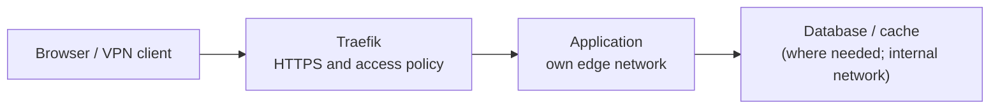

<div align="center">

# Secure Docker Blueprint

**Self-host on Docker — secure from the first start.**

Pick the apps you need from **120+ ready-made setups**. Each one runs behind the same
protection: HTTPS and access control through Traefik, isolated networks, secrets in
files, and CrowdSec if you want it.

The protection sits around the apps, not inside them — the images stay as upstream
ships them. Every default can be changed.

For applications you build yourself, [`development/`](development/) provides two
deployment patterns: a **static site** and a **web API**, following the same
**deploy → secure → operate → recover** approach.

[](https://github.com/rubennati/secure-docker-blueprint/actions/workflows/ci.yml)
[](https://github.com/rubennati/secure-docker-blueprint/actions/workflows/trivy.yml)
[](https://scorecard.dev/viewer/?uri=github.com/rubennati/secure-docker-blueprint)
[](https://www.bestpractices.dev/projects/13091)
[](LICENSE)
[](CHANGELOG.md)

**[Architecture](docs/architecture.md) · [Standards](docs/standards/) · [Stacks at a glance](LIFECYCLE.md) · [SecDockBlue](https://secdockblue.rubennati.at)**

</div>

Run self-hosted software without getting the security details wrong each time.
The shared security baseline uses file-based Docker Secrets where supported,
isolates datastores on internal networks without published ports, pins images,
and sets memory and PID limits. Traefik handles TLS and access control. Each stack
records deviations from the baseline in its own documentation.

[CrowdSec](core/crowdsec/) adds optional threat detection. Its
[AppSec component](core/crowdsec/docs/appsec.md) is opt-in and ships without the
OWASP Core Rule Set.

Quick Navigation: [Stacks](#stacks) · [Try a stack](#try-a-stack-on-your-machine) · [New host](#set-up-a-new-host) · [Add or update](#add-a-stack-to-a-host) · [Documentation](#documentation)

## Stacks

121 stacks in five categories. Each stack groups the configuration for an
application or infrastructure component; it may contain several containers or
run as a host tool. Each category below links to its full list.

| Browse | Stacks | Examples |
|---|---|---|
| [**`core/`** — proxy, identity, threat detection, secrets, Docker management](core/) | 21 | Traefik · Authentik · Keycloak · Authelia · CrowdSec · Infisical · dnsmasq · Portainer |
| [**`apps/`** — general self-hosted applications](apps/) | 63 | Nextcloud · Immich · Paperless-ngx · Vaultwarden · Stalwart · Ollama · Windmill · Ghost · n8n |
| [**`business/`** — invoicing, project management, helpdesk, analytics, e-signature](business/) | 19 | Invoice Ninja · OpenProject · Vikunja · Zammad · Matomo · Documenso |
| [**`monitoring/`** — uptime, metrics, notifications](monitoring/) | 14 | Uptime Kuma · Gatus · Beszel · Healthchecks · ntfy · Langfuse |
| [**`backup/`** — this host outward, your devices inward](backup/) | 4 | Borgmatic · UrBackup |

Where several tools solve the same problem, more than one is included.

**What a host needs.** Only Traefik is required: every stack that publishes a domain
routes through it. CrowdSec is recommended — it detects attacks in the logs and blocks
only once you enable a remediation; its AppSec component (Coraza, with the optional
OWASP Core Rule Set) is opt-in. Everything else in `core/` — identity, secrets, DNS and
certificates, Docker management, bastions — is optional shared infrastructure, often
several alternatives for one job: install it when you need it. `stacks.example` starts
with Traefik, CrowdSec and the `whoami` test target.

## How the pieces fit

A typical HTTPS application follows this path. Traefik applies the stack's access
policy; the database or cache, where needed, stays on its internal network.



[Architecture](docs/architecture.md) covers optional integrations, host controls
and the boundaries between them.

**A blueprint, not a fixed product.** Each stack ships secure defaults — closed access,
secrets in files, pinned images, resource limits — and every one can be changed in
`.env` or an overlay. What a stack may assume from the platform and what it must provide
itself is [the application contract](docs/architecture.md#the-application-contract).

## Getting started

Four ways in, depending on what you want to do.

### Try a stack on your machine

Most stacks ship a local variant: localhost, no Traefik, no domain, none of the
protection around it. It shows the application, not how it runs on a host.

```bash
# Get the repository and pick a stack
git clone https://github.com/rubennati/secure-docker-blueprint.git
cd secure-docker-blueprint/apps/vaultwarden

# Local settings; the secrets ship empty, so fill the ones this stack needs
cp .env.local.example .env.local
printf 'DB_PASSWORD=%s\nDB_ROOT_PASSWORD=%s\n' "$(openssl rand -hex 16)" "$(openssl rand -hex 16)" >> .env.local

# Start it
docker compose -f docker-compose.local.yml --env-file .env.local up -d
```

The stack's README, section *Try it locally*, gives the URL and any first-login step.

### Set up a new host

Install Traefik before the application stacks that use its HTTPS routing.
Each stack is then installed from its own README. Services with additional
protocols, such as [mail](apps/docker-mailserver/README.md#architecture), may
publish their own ports through an opt-in overlay; their guides describe those
ports and prerequisites.

**Requirements:** Docker Engine 28.0+ with Compose 2.33.1+, a Linux host (tested on Debian 12/13),
`envsubst` (`gettext-base`), and a domain whose DNS you control. The shipped DNS-01
resolver uses Cloudflare; HTTP-01 and TLS-ALPN-01 work with other DNS providers.
Most stacks start closed, reachable over the VPN only; those built to be reached from
the internet, such as sign-in or link sharing, start public. A VPN is the recommended
way in, and the shipped configuration uses Tailscale. Without one, admit your own
networks through `TRUSTED_RANGES` and `access-trusted`; the Traefik dashboard then
stays closed, and no setup step needs it.

A host checks out only the stacks it runs. `/srv/docker` is the recommended location,
not a required one:

```bash
# An empty directory you own
sudo mkdir -p /srv/docker && sudo chown "$USER" /srv/docker

# Clone without files, then take the newest release
git clone --sparse --no-checkout https://github.com/rubennati/secure-docker-blueprint.git /srv/docker
cd /srv/docker
git checkout "$(git tag --sort=-v:refname | head -n1)"
git sparse-checkout set scripts docs/standards

# The stacks on this host, one per line; check out what the file lists
cp stacks.example stacks
scripts/stacks.sh apply

# Start with Traefik
cd core/traefik
cp .env.example .env
```

`stacks` starts with Traefik, CrowdSec and the `whoami` test target.

Deploy from a tag rather than the default branch: `main` is where work lands between
releases, and the combination of stacks on it at any moment is not one anybody has
operated. [`docs/standards/deployment-lifecycle.md`](docs/standards/deployment-lifecycle.md)
covers the rest of the cycle — deployment order, updating the blueprint as against
updating an upstream image, rollback, and how a host states which release it runs.

Continue with **[Traefik setup](core/traefik/README.md#setup)** before starting
containers. It covers the required choices: IPv4-only or dual-stack (including a
real IPv6 subnet and Docker daemon prerequisites), certificate strategy, and VPN
access. The example intentionally leaves the certificate strategy unselected and
uses an IPv6 documentation prefix that validation refuses.

Once Traefik is running and its checks are complete, install an application from
its own README — for example [Vaultwarden](apps/vaultwarden/README.md) or
[Nextcloud](apps/nextcloud/README.md). On a 403 or 404,
[TROUBLESHOOTING.md](TROUBLESHOOTING.md) maps the symptom to its cause.
Run `./scripts/overview.sh` **from the repository root** to list what is configured
and running.

### Add a stack to a host

Add its path to `stacks`, run `scripts/stacks.sh apply`, then follow the stack's
README. Removing a line and applying again removes the stack; apply refuses while the
stack still has `.env` or data, because Git would delete them with the directory.

### Update a host

```bash
scripts/stacks.sh update <tag>
```

shows what a release changes for exactly the stacks on this host, and takes it only
after you confirm. Moving one stack to a newer upstream image within a release is a
separate step — both are in the
[deployment lifecycle](docs/standards/deployment-lifecycle.md#7--update-the-blueprint).

## Repository layout

```text
core/         shared infrastructure and control plane
apps/         general self-hosted applications
business/     business applications
monitoring/   monitoring and observability
backup/       backup and recovery
development/  reusable patterns for software you build yourself
docs/         architecture, standards and records (index: docs/README.md)
scripts/      CI checks, the overview script and the stack list tool
site/         SecDockBlue source
```

Compose-based stacks normally contain `docker-compose.yml`, `.env.example`, a
`README.md` with setup instructions, an `UPSTREAM.md` recording image pins,
upgrade notes and verification, and most a local variant
(`docker-compose.local.yml`, `.env.local.example`). [`apps/_reference/`](apps/_reference/) provides
the application template. Host-installed components such as
[Borgmatic](backup/borgmatic/) and the optional [Host Watchdog](core/host-watchdog/)
have their own installation layout.

## Deploy → secure → operate → recover

Four phases, and the repository covers all of them:

- **Deploy** — a shared structure for Compose stacks, with configurable values documented in `.env.example`; host-installed tools have their own setup guides
- **Secure** — `no-new-privileges`, Docker socket proxies, file-based secrets with documented exceptions, datastores unreachable from the host network, memory, PID and swap limits — checked on every pull request; capabilities dropped and a read-only root filesystem wherever the image allows it
- **Operate** — healthchecks, resource and swap limits, monitoring stacks, and the date and version each stack last ran on a host
- **Recover** — Borgmatic with database-aware dumps, and restore playbooks per persistence pattern

[`docs/architecture.md`](docs/architecture.md) covers the networking model and how the
five categories are divided. [`docs/standards/`](docs/standards/) holds the rules each
stack is checked against.

## Status

**Pre-1.0** — paths, variable names and defaults can still change.

[`LIFECYCLE.md`](LIFECYCLE.md) shows one row per stack: the pin and when upstream
released it, the newest upstream release, the CRITICAL and HIGH findings in the
upstream images, and when the stack last ran on a host. Between two updates of
that file, the weekly [stack status](https://github.com/rubennati/secure-docker-blueprint/issues?q=is%3Aissue+is%3Aopen+label%3Astack-status)
shows what upstream has published since.

## Documentation

| Using the blueprint | |
|---|---|
| Every stack, by category | [core/](core/) · [apps/](apps/) · [business/](business/) · [monitoring/](monitoring/) · [backup/](backup/) |
| Pin, upstream, findings and last test per stack | [LIFECYCLE.md](LIFECYCLE.md) |
| Deploy, update, roll back a host | [deployment lifecycle](docs/standards/deployment-lifecycle.md) |
| Symptom-to-cause troubleshooting | [TROUBLESHOOTING.md](TROUBLESHOOTING.md) |
| Applications you build yourself | [development/](development/) (patterns) · [docs/standards/custom-application.md](docs/standards/custom-application.md) (rules) |
| Guided operator documentation | [SecDockBlue](https://secdockblue.rubennati.at) |
| Release history | [CHANGELOG.md](CHANGELOG.md) |

| Developing the blueprint | |
|---|---|
| Networking model, categories, capabilities | [docs/architecture.md](docs/architecture.md) |
| What a stack may assume and must provide | [application contract](docs/architecture.md#the-application-contract) |
| Compose, env, secrets, networking, restore rules | [docs/standards/](docs/standards/) |
| Adding a stack, contributing | [CONTRIBUTING.md](CONTRIBUTING.md) · [new-app checklist](docs/standards/new-app-checklist.md) |
| Reporting a vulnerability | [SECURITY.md](SECURITY.md) |
| Repository maintenance process | [docs/maintenance.md](docs/maintenance.md) |
| Planned work and what is out of scope | [ROADMAP.md](ROADMAP.md) |

## License

[Apache License 2.0](LICENSE)
