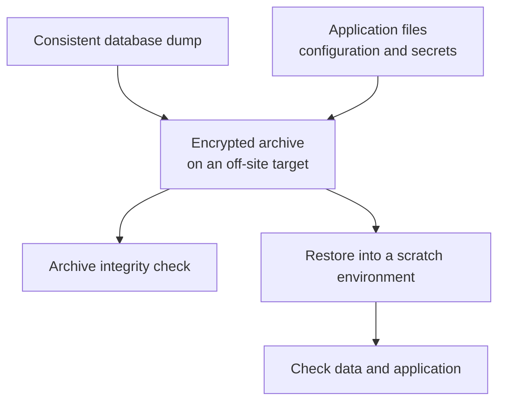

# Backup

Backup has two directions, and a self-hoster needs both:

- **This infrastructure** — the Docker host and everything it runs. Recovered with [Borgmatic](borgmatic/).
- **The machines around it** — your laptop, desktop, other servers, backed up *to* infrastructure you own instead of somebody's cloud. That is [UrBackup](urbackup/).

They solve different problems and neither replaces the other. See
[`docs/architecture.md`](../docs/architecture.md#directory-structure) for how this
category is defined relative to the other four.

What has been established about each stack — verified against which version and when, whether a restore was performed — is in [`LIFECYCLE.md`](../LIFECYCLE.md), generated from the repository.

| Tool | Direction | Notes |
|---|---|---|
| [Borgmatic](borgmatic/) | This host → off-site | **The documented default for server backup.** Host-installed; a backup and a restore have both been performed and are logged in [`borgmatic/RESTORE.md`](borgmatic/RESTORE.md#rehearsal-log). Append-only enforcement is the one documented mechanism not yet exercised. |
| [UrBackup](urbackup/) | Your devices → this host | Client backup for Windows, macOS and Linux; whole-disk image restore on Windows. Checked with a Linux client: a file backup and its download. |
| [Rclone Web](rclone-web/) | Files ⇄ storage providers | Browser interface for rclone: remotes, copy and sync jobs, serves. Interface and API on one host; the API holds every remote's credentials. |
| [Kopia](kopia/) | Your machines → this host | Repository server: each machine runs its own Kopia client with its own account and never holds the repository password. Deduplicated and encrypted; the repository lives on this host's disk or on a remote provider. |

## Planned

Not deployable here yet. See [`ROADMAP.md`](../ROADMAP.md) for status.

- **Bareos** — tape / regulated-retention backup. Bareos publishes no image, so it
  waits for one built here — see
  [`../docs/audits/candidate-evaluation-2026-09-22.md`](../docs/audits/candidate-evaluation-2026-09-22.md#decided-on-2026-09-22).

---

## What this category covers, and where it stops

**In scope:** backup and restore of the stacks in this repository — which data matters, how to capture it consistently, where to put it, and how to prove a restore actually works.

**Out of scope:** business continuity management and incident response as disciplines — business impact analysis, crisis communication, emergency manuals, insurance. Those are referenced (see [Standards](#standards)) and left to dedicated frameworks. This category stays operational.

**The server-backup agent is host-installed by design.** Borgmatic needs access
to the data it protects and must be available when Docker is down. The procedure
below explains this choice; the [Borgmatic guide](borgmatic/README.md) gives the
supported host prerequisites and installation steps.

---

## Three layers people conflate

Getting these mixed up is the single most common way to end up with no usable recovery.

| | Snapshot | Backup | Archive |
|---|---|---|---|
| **Examples** | btrfs, ZFS, LVM, hypervisor or provider snapshots | Borg/Borgmatic, Kopia, Restic | WORM object storage, tape, cold storage |
| **Protects against** | accidental change, a bad upgrade — rollback in seconds | disk failure, fire, theft, ransomware | long-term loss; legal and retention obligations |
| **Retention** | hours to days | weeks to months | years to decades |
| **Fails when** | the underlying storage is lost — the snapshot goes with it | the only copy sits where a compromised host can reach it | nobody ever verifies it is still readable |

A snapshot depends on the original. Lose the disk and you lose both. **A snapshot is not a backup**, no matter how convenient the rollback.

The same applies to a provider's built-in backup product with a short fixed retention — typically seven rolling days. It covers "the server broke on Tuesday". It does not cover data you discover missing three weeks later, and it does not cover ransomware that sat quietly before it triggered. Useful, but not a long-term backup and not an archive.

---

## Where the backup agent belongs

**This blueprint installs Borgmatic on the host**, scheduled by a systemd timer:

- **Data access is explicit.** The agent reads the selected application data,
  configuration and secrets. Its host permissions and backup credentials are a
  trust boundary: it can read what those permissions grant, and the archive must
  protect the captured secrets. A server-wide backup can read secrets across
  stacks; keeping that reach in the host's administrative boundary avoids
  granting it to another application container.
- **Recovery does not depend on a running Docker daemon.** The host agent can
  access archives and restore files while Docker is unavailable. Database dump
  hooks and database restores still need the database to be reachable.
- **Database consistency is handled separately.** Container-aware hooks take
  dumps before the file backup; [the next section](#layer-1--application-consistent-database-backups)
  describes that path and the host client requirements.

A containerised backup agent is technically possible with mounts limited to the
paths it protects; neither a host-root mount nor privileged mode is inherently
required. It still gains read access to the mounted data and needs Docker to
start. This repository keeps the server-wide Borgmatic agent on the host rather
than maintaining both deployment paths.

> For a containerised agent, scope mounts to the required data, use read-only
> mounts where possible, and keep `no-new-privileges` and `cap_drop: ALL`.
> Never mount the Docker socket into that backup container. Use a documented
> database-consistency mechanism rather than granting Docker control merely to
> read files. The agent's data access and credentials define its blast radius.

---

## The five layers in practice

The server-backup path documented for Borgmatic:



[Database consistency](#layer-1--application-consistent-database-backups) explains
what must happen before archiving. [Recovery checks](#layer-4--proving-it-works)
distinguish an intact archive from a successful restore; the
[restore playbook](borgmatic/RESTORE.md) gives the commands.

| Layer | What it does | Where it runs |
|---|---|---|
| 0 · Snapshot | Fast local rollback | Host filesystem or provider — **explained here, not implemented by this repo** |
| 1 · Consistency | Database dumps before the file backup runs | Borgmatic hook, reaching into the container |
| 2 · File data | Bind mounts and named volumes | Host agent |
| 3 · Off-site | 3-2-1, encryption, immutability | Remote target |
| 4 · Proof | Restore rehearsal, integrity check, run monitoring | Host + `monitoring/` |

### Layer 1 — application-consistent database backups

Copying a running database's files at the file level can capture a torn, mid-transaction state. The backup reports success; you find out at restore. Always take a logical dump.

Borgmatic dumps natively for **PostgreSQL, MySQL, MariaDB, MongoDB and SQLite** — which covers every engine in this repository. Since **Borgmatic 2.0.8** it can address a database *inside a container* directly:

```yaml
postgresql_databases:
  - name: caldiy
    # The server's own client, inside its container (FA-03)
    pg_dump_command: docker exec caldiy-db pg_dump
    pg_restore_command: docker exec -i caldiy-db pg_restore
    psql_command: docker exec -i caldiy-db psql
```

Borgmatic asks Docker for the container's address and connects. No published ports. The dump runs on the host, so the host needs a client for each engine — except PostgreSQL, whose dump runs with the server's own client through `docker exec` ([borgmatic/README.md](borgmatic/README.md#postgresql-the-servers-own-client-through-docker-exec)). Dumps stream straight into the archive through named pipes — no intermediate files with awkward permissions.

Restore is `borgmatic restore --archive latest --database <name>`. Two things to know before you need it: **restore is destructive** — it replaces the live database — and **the database must already exist**; Borgmatic does not create it.

Borgmatic includes its own configuration file in the archive, so the credentials needed for a restore travel with the backup. That is convenient and it means the archive must be encrypted.

> **Older Borgmatic, or a different tool:** publish the database port to `127.0.0.1` and point the hook at it, or run the dump in a `before_backup` hook via `docker exec`. If you use a hook, make it **fail loudly** — a dump command that errors while the backup continues produces an archive that looks fine and contains nothing. Kopia and Restic have no database hooks; there you script the dump yourself.

**Where the per-app detail lives.** Each app README carries a `## Backup` section — which database and container, which volumes hold state, which are reproducible, whether the app needs quiescing, and a copy-pasteable borgmatic block. The template is in [`apps/_reference/README.md`](../apps/_reference/README.md). That way `/etc/borgmatic/config.yaml` is assembled from the apps rather than reverse-engineered from their compose files at the moment someone needs a restore. `LIFECYCLE.md` reports which apps still lack it.

### Layer 2 — both volume types, no preference

The blueprint uses bind mounts under `./volumes/` for most stacks and named volumes for a few. **Both are valid** — Docker itself recommends named volumes for portability and notes they are not suited to direct host access. The backup has to handle whatever an operator already runs.

| | Bind mount | Named volume |
|---|---|---|
| **How to back it up** | Add the path to `source_directories` | Helper container: `docker run --rm --volumes-from <stack> -v /backup:/backup …`, or add the Docker volume directory to `source_directories` |
| **Caveat** | none — it is an ordinary directory | the storage path is Docker-internal and differs under rootless Docker or a custom data root; copying it while containers write can be inconsistent |

If you are building fresh and have the choice, bind mounts make host-level backup simpler. If you already run named volumes, use the helper-container pattern — that is a documented approach, not a workaround.

### Layer 3 — off-site, and what ransomware protection really buys

3-2-1: three copies, two media types, one off-site. The newer 3-2-1-1-0 adds one offline or immutable copy and *zero* unverified backups — that last digit is monitoring, and it is the part most often skipped.

**Borg's append-only mode is weaker than it is usually described.** Borg's own documentation is explicit:

> "this only affects the low level structure of the repository, and running delete or prune or reading from the repository will still be allowed"

So a compromised client **can** make archives disappear logically. What append-only buys you is that the data is not physically removed: you can roll back to an earlier transaction using the repository's transaction log, by deleting segment files written after it. That recovery is manual, and **it only works if `borg compact` has not run since**. Append-only is also "not respected by tools other than Borg" — anyone with filesystem access to the repository bypasses it entirely.

Treat append-only as **delay and recoverability, not prevention**. What actually raises the bar:

- **Put the repository where the client cannot reach it.** A pull architecture, or a target the production host holds no delete credentials for.
- **Immutability at the storage layer.** S3 Object Lock in *compliance* mode cannot be bypassed until retention expires. *Governance* mode can be bypassed by anyone holding the bypass permission — it is not equivalent.
- **Keep the key off the host.** With `repokey` encryption the key material lives in the repository; export it with `borg key export` and store it, plus the passphrase, somewhere the production host does not reach. Both are required to restore — a host compromise must not hand over the backups, and losing the host must not lose the key.
- **Notice quickly.** Every recovery path above depends on discovering the problem before compaction or retention erases the evidence.

### Layer 4 — proving it works

A backup nobody has restored is a hypothesis. Three distinct checks, often confused:

| Check | Answers | How |
|---|---|---|
| Did the job run? | scheduling, silent failure | Borgmatic pings a monitor on start/finish/failure |
| Is the archive intact? | bit rot, truncation | `borgmatic check` on a schedule |
| Does the data come back? | the only question that matters | restore rehearsal into a scratch environment |

Borgmatic has built-in integrations for **Healthchecks** and **Uptime Kuma** — both already in [`monitoring/`](../monitoring/README.md). The dead-man's-switch pattern is what catches the failure mode where the timer silently stopped weeks ago.

Set an **RPO** (how much data may be lost — this sets backup frequency) and an **RTO** (how fast you must be back — this sets what you keep ready). For a single-operator setup, writing down "at most 24 hours of data, back within a day" and then configuring to match is enough. Undefined objectives produce undefined backups.

---

## Staged adoption

Do not build all of this at once. In order of risk reduction per unit of work:

**Stage 1 — the floor.** Encrypted daily backup of application data and compose configuration to one off-site target. Database hooks enabled for every stack that has a database. Key and passphrase stored off the host. *At this point you have a backup.*

**Stage 2 — trust it.** A restore rehearsal, written down. `borgmatic check` on a schedule. A monitor that alarms when a run is missed. *At this point you know the backup works.*

**Stage 3 — harden it.** A second copy on different media. Append-only or storage-level immutability, configured with its real limits understood. *At this point ransomware costs you time instead of everything.*

**Stage 4 — retain it.** Archive tier for anything with a long-term or legal retention need, with readability verified.

Prioritise by what hurts most to lose: databases first, then configuration and application data, then anything reproducible.

---

## Anti-patterns

- **Snapshots sold as backups.** They complement backups; they never replace them.
- **Untested backups.** "Job succeeded" is not evidence. Only a restore is.
- **A hook that fails quietly.** A dump command that errors while the backup continues produces an archive that looks complete and restores nothing.
- **Key and data on the same host.** Then one compromise takes both.
- **Governance-mode Object Lock treated as immutable.** It can be bypassed by design.
- **Relying solely on a provider's short-retention backup.** It covers outages, not late discovery.
- **Append-only assumed to be deletion-proof.** See Layer 3.

---

## Per-app separation — an option, not a rule

Separate repositories per app give independent retention, surgical restore and independent failure. They also multiply the number of configurations, schedules and restore rehearsals — and a rehearsal you never run is worse than a shared repository you have actually restored from.

**Start with one host-level configuration covering everything.** Split out an app when it has a genuinely different retention requirement, or when its data is large enough that a shared schedule stops working. Borgmatic supports multiple configuration files for exactly this.

---

## Layout

Backup differs structurally from every other category here: the agent is installed on the host, so `backup/borgmatic/` holds configuration and procedure rather than a Compose stack.

```text
backup/borgmatic/
├── config.yaml.example      # source directories, database hooks, retention, monitoring
├── borgmatic.timer.example  # systemd schedule
├── README.md                # setup, targets, key handling
└── RESTORE.md               # the rehearsal, step by step
```

A tool that does run in a container follows the normal stack layout with `docker-compose.yml` and `.env.example` — [`kopia/`](kopia/) is the one that does, in repository-server mode: the container holds the repository, and the agent that reads a machine's files stays on that machine.

---

## Standards

Useful for structuring a backup concept, and required if you fall under one of them:

| Framework | What it asks for |
|---|---|
| **BSI IT-Grundschutz CON.3** | A written data backup concept: what is backed up, how often, retained how long, and evidence that restore was tested. RPO per system. Backups automated and protected against unauthorised access. |
| **NIST SP 800-34** | Backup frequency and off-site storage derived from criticality; RPO and RTO defined separately from maximum tolerable downtime; recovery plans tested. |
| **ISO 22301** | Recovery objectives defined and exercised as part of business continuity. |
| **NIS2** | Backup management and disaster recovery named explicitly under business continuity — binding for essential and important entities. A private self-hoster is normally out of scope but the practices transfer. |

All four converge on the same four verbs: **plan, document, protect, test.** For a single operator that means a short written concept, automated encrypted backups, and a restore you have actually performed.
