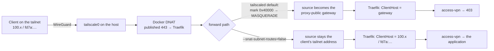

# The exposure profile, the host firewall and the exposure test

What `core/traefik` says about exposure, what it renders for the host, and
what only a request from outside the host can show. The decision is
[DEC-078](../../../.ai/decisions.md#dec-078); the audit behind it is
[`docs/audits/ingress-architecture-2026-10-31.md`](../../../docs/audits/ingress-architecture-2026-10-31.md).

## Three things that are kept apart

| | Says | Comes from |
|---|---|---|
| **The profile** | what the configuration intends to expose: `direct`, `proxied` or `private` | `validate.sh`, derived from `TRAEFIK_BIND_V4`, `TRAEFIK_BIND_V6` and `TRAEFIK_FORWARDED_PROXY`; there is no exposure variable |
| **The layers** | which protection is present and which is absent, with the risk its absence leaves | `validate.sh`, for the derived profile |
| **The measurement** | what the internet reaches | `scripts/exposure-test.sh`, run from another machine; its marker line is what `validate.sh --strict` requires for a public binding |

NAT, a router, a hoster's firewall or the absence of any of them decide what is
reachable. The profile is printed; the measurement is recorded; neither is
mistaken for the other.

## The profile

| Profile | Derived when | What the ruleset does for it |
|---|---|---|
| `direct` | a binding is `0.0.0.0`, `[::]` or a global address, and `TRAEFIK_FORWARDED_PROXY=none` | closes the host's input path; leaves the published ports open to everyone |
| `proxied` | such a binding with `TRAEFIK_FORWARDED_PROXY=cloudflare` | the same, and the published ports answer Cloudflare's ranges, the VPN and `TRUSTED_RANGES` alone |
| `private` | every binding is a loopback, LAN, VPN or link-local address, or nothing is published | closes the host's input path; no rule on the published ports |

The two bindings are the ones `config/published-ports.yml` publishes: an empty
variable publishes nothing for its family, and neither has a default (`render.sh`
refuses `TRAEFIK_BIND_V4` unset).

## The mandatory invariants and the layers

What the blueprint guarantees inside the host holds in every profile and is
what `validate.sh` checks before it prints the profile: only Traefik is
published, on named addresses; backends are never published; the networks are
isolated as decided; no address class is trusted; forwarded headers are
sanitised by sender; forward-auth fails closed; the management path does not
run through Traefik or Docker.

Everything beyond that is a layer, and `validate.sh` lists each for the profile:

| Layer | Class | When absent |
|---|---|---|
| host firewall (`config/host/ingress.nft`) | recommended | `direct`: every published port answers the internet unfiltered, and the VPN's IPv6 range is not spoof-protected · `proxied`: a direct client that knows the origin bypasses Cloudflare · `private`: no host-level gate, acceptable where an upstream firewall is the gate |
| CrowdSec entrypoint bouncer | recommended | no detection or remediation at the entrypoint |
| forward-auth | optional | an application with a weak login has no gate in front — the posture lines name each |
| Cloudflare origin protection (`proxied`) | optional, not verifiable here | without Authenticated Origin Pulls or a tunnel, the host firewall is what keeps a direct client out |
| the exposure test | required for a public binding under `--strict` | the profile is unmeasured |

Nothing optional is an error by its absence; nothing absent is silent.

## The host firewall

`render.sh` writes `config/host/ingress.nft` for the derived profile. It is an
`nftables` ruleset in its own table, `inet blueprint_ingress`, next to the
tables Docker and Tailscale manage, and it is installed by the operator
([`ops/host-files.manifest`](../ops/host-files.manifest), `optional`), never
applied by anything in this repository.

What it does:

- **Input: closed, except what the host needs and the VPN brings.** Loopback,
  established connections, ICMP and ICMPv6, the DHCP clients, Tailscale's own
  port 41641 — and everything from the VPN ranges (`TAILSCALE_CIDR_V4`,
  `TAILSCALE_CIDR_V6`). SSH therefore answers the VPN and nothing else. A
  published container port never traverses this hook: Docker translates and
  forwards it, so 80 and 443 need no input rule.
- **Forward: open.** Docker's own traffic runs on the forward path and the
  policy stays `accept` ([`docs/standards/networking.md`](../../../docs/standards/networking.md),
  "A host firewall and Docker share the forward path"). Two rules only: the
  VPN's IPv6 range is dropped on every interface but `VPN_INTERFACE` (Tailscale
  installs that rule for IPv4 alone), and in the `proxied` profile a new
  connection to Traefik's translated 80 or 443 is dropped unless it comes from
  Cloudflare, the VPN or a trusted range.
- **No automatically filled set reaches the management plane.** The sets are
  rendered from `.env`; the CrowdSec host bouncer, when it runs, owns a table of
  its own on the forward hook
  ([`core/crowdsec/docs/firewall-bouncer.md`](../../crowdsec/docs/firewall-bouncer.md)).

Loading it — from a session that arrives over the VPN, with a way back. The step 8 lab
host used a timer instead of the backgrounded `sleep` below, because `pkill -f` also
matches the shell that runs it (`docs/host-baseline.md`, MUST 7):

```bash
sudo systemd-run --unit=fw-rollback --on-active=300 /usr/sbin/nft delete table inet blueprint_ingress
sudo nft -f /etc/nftables.d/ingress.nft
# a NEW session over the VPN works? then:
sudo systemctl stop fw-rollback.timer
```

For persistence, `/etc/nftables.conf` must not begin with Debian's `flush ruleset`; the lab
host's file held `destroy table inet blueprint_ingress` and `include
"/etc/nftables.d/ingress.nft"` alone, and `nftables.service` enabled.

The original form:

```bash
sudo nft -c -f core/traefik/config/host/ingress.nft          # syntax, nothing applied
sudo cp core/traefik/config/host/ingress.nft /etc/nftables.d/ingress.nft
# behind Cloudflare, cloudflare-ranges.nft has to be installed first — the ruleset includes it
sudo sh -c 'nft -f /etc/nftables.d/ingress.nft; (sleep 300; nft delete table inet blueprint_ingress) &'
# the session still answers? then cancel the way back:
sudo pkill -f 'sleep 300'
```

Make it survive a reboot the way the host loads `nftables` (an `include` from
`/etc/nftables.conf`, or `nftables.service`); `scripts/host-files.sh` compares the
installed file with the rendered one. Debian's `/etc/nftables.conf` begins with
`flush ruleset`: starting or restarting `nftables.service` on a running host removes
Docker's tables as well, and published ports stop until Docker writes them again.
Verify the forward path by result:
a throwaway container on a bridge network still reaches an external address.

Not loaded on a host yet by this repository (DEC-078, verification open). What is
checked: `nft -c` accepts every rendered profile (`scripts/ci/test_traefik_exposure.py`).

## The exposure test

```bash
bash scripts/exposure-test.sh <the host's address> <direct|proxied|private>
```

Run it from a machine that is not on the VPN. Behind Cloudflare give the origin
address, never the proxied name — the name resolves to Cloudflare's edge, which
answers for everyone. It probes 80 and 443 over IPv4 and IPv6, the ports that
must never answer (Traefik's API, the Docker API, a sample of backend ports) and
reports SSH without judging it. When the host exposes what the profile says, the
last line is the marker:

```text
EXPOSURE_MARKER date=2026-11-01T10:00:00Z target=203.0.113.10 profile=direct result=ok
```

Append it on the host, in `core/traefik` — one line per run, so a run per address
keeps both families on record; `validate.sh` reads the last line:

```bash
printf '%s\n' 'EXPOSURE_MARKER …' >> config/exposure-verified
```

`validate.sh` prints when and against what the test ran; `--strict` fails a
public binding without the marker and refuses a marker for another profile.
Repeat the test after a change of bindings, proxy mode or firewall — the marker
is a record of one measurement, not a property of the host.

## Management access

Two independent paths, identity by key, and nothing automatic between them:

- **The VPN** carries administration. The ruleset admits the host's services from
  the VPN ranges only; SSH takes keys (`PasswordAuthentication no`).
- **A second path that does not depend on ingress** — the hoster's console, a
  second interface, a serial line — for the day the first one is gone.
- **No automatically filled rule reaches the management interface.** The
  CrowdSec host bouncer writes its set into its own chain on the forward hook,
  matched to the public interface; nothing it decides touches the input path.

`validate.sh` names the requirement; the second path is the operator's to keep
and cannot be checked from the host.

## Reaching the routers over Tailscale on the host

`access-vpn` and `access-trusted-vpn` admit a request when the address Traefik
sees lies in `TAILSCALE_CIDR_V4` or `TAILSCALE_CIDR_V6`. With Tailscale installed
on the Docker host and its defaults left as they are, that address is never the
client's: every tailnet client reaches Traefik as the Docker gateway of
`proxy-public`, and every VPN-only router answers 403.



**Why.** A connection to Traefik's published port is translated by Docker
(`DNAT` to the container's address) and then *forwarded* to the bridge, not
delivered locally. `tailscaled` marks every packet it forwards from `tailscale0`
(`ts-forward`: `-i tailscale0 -j MARK --set-xmark 0x40000`) and masquerades every
marked packet on the way out (`ts-postrouting`: `-m mark --mark 0x40000 -j
MASQUERADE`) — the SNAT it applies to subnet-router traffic, on by default. The
container then sees the bridge gateway as the source, over IPv4 and over IPv6.

**Why it seems to come and go.** Docker and `tailscaled` each put their jump at the
top of the `FORWARD` chain when they start, and nothing orders the two services. When
Docker started last, its chains accept the forwarded connection before `ts-forward`
marks it, and the client address survives; when `tailscaled` started last, every
connection is marked and masqueraded. Measured on the step 8 lab host with the
default: Docker restarted after Tailscale — the tailnet client got 200; `tailscaled`
restarted after Docker — 403 for every VPN client. A reboot, an update of either
package or a restart of either service decides it anew. With the fix below the order
no longer matters — measured in both orders and over a reboot.

**The fix.** On a host that does not route subnets for the tailnet:

```bash
sudo tailscale set --snat-subnet-routes=false
sudo iptables -t nat -S ts-postrouting     # no MASQUERADE line left
sudo ip6tables -t nat -S ts-postrouting    # the same for IPv6
tailscale debug prefs | grep NoSNAT        # "NoSNAT": true
```

The setting is a preference of the node: it survives a restart of `tailscaled`
and needs no new login. SSH and every other service of the host itself are not
affected — locally delivered traffic never crossed this rule. To check from the
outside, open a VPN-only router from a tailnet client and read `ClientHost` in
Traefik's access log: it has to be the client's tailnet address.

**Measured** on the step 8 lab host (2026-11-03: Debian 13, Docker Engine 29.9.2 with
`userland-proxy: false`, Traefik published on `0.0.0.0` and `[::]`, Tailscale 1.104.5
from its Debian repository, `tailscale up` with SSH, exit node, routes and DNS off):

| | Before | After `--snat-subnet-routes=false` |
|---|---|---|
| `ts-postrouting` | `MASQUERADE` for the mark, IPv4 and IPv6 | empty |
| `ClientHost` of a tailnet client (IPv6) | the `proxy-public` ULA gateway | the client's `fd7a:…` address |
| `ClientHost` of a tailnet client (IPv4) | the `proxy-public` gateway (`172.x`) | the client's `100.x` address |
| a VPN-only router from that client | 403 | 200 over both families — browser and `curl`; the access matrix A1–A5, A8 and G7 as expected; no error in Traefik, CrowdSec or `tailscaled` |
| SSH to the host's tailnet IPv4 | — | works |
| the same routers from outside the tailnet | 403 | 403 |
| after `systemctl restart tailscaled` | — | the preference held, no `MASQUERADE` rule |

**What else it touches** — not measured here, stated from how the rule works:

- **A host that is also a subnet router or exit node** loses the SNAT for that
  routed traffic: the routed LAN then needs a return route to the tailnet ranges,
  or the replies go nowhere. Such a host keeps the default and needs another way
  for the client address, or the role moves to another machine.
- **Without the fix, every tailnet client shares one address** — the gateway's.
  `TRUSTED_RANGES` must never contain it (`validate.sh` refuses Docker subnets
  there), per-client rate limits count all VPN users as one, and CrowdSec sees a
  private address it whitelists, so nothing a VPN client does is attributed to it.
- **Headscale clients** run the same `tailscaled` and are assumed to behave the same.
- **Tailscale inside a container, or on a different machine than Traefik**, does not
  meet this rule on the Docker host; it is not covered by this note.
- Testing from the host itself tells nothing: the host's own connection to its
  published port is re-sourced by Docker regardless (`docs/standards/troubleshooting.md`).

**Names resolve to the public address unless told otherwise.** A record that points
at the host's public address sends a tailnet client over the internet, not the tunnel,
and the VPN-only router answers 403 with the client's public address in `ClientHost`.
The lab zone needed split DNS: a resolver on the tailnet that answers the zone with the
host's tailnet addresses — **both** `A` and `AAAA`; with only `A`, an IPv6-preferring
client took the public IPv6 address from upstream and left the tunnel again. On the lab
host that was [`core/dnsmasq`](../../dnsmasq/) on `tailscale0` (two `address=` lines,
one per family); a resolver the tailnet already uses works the same way, or Tailscale's
split DNS pointed at it.
