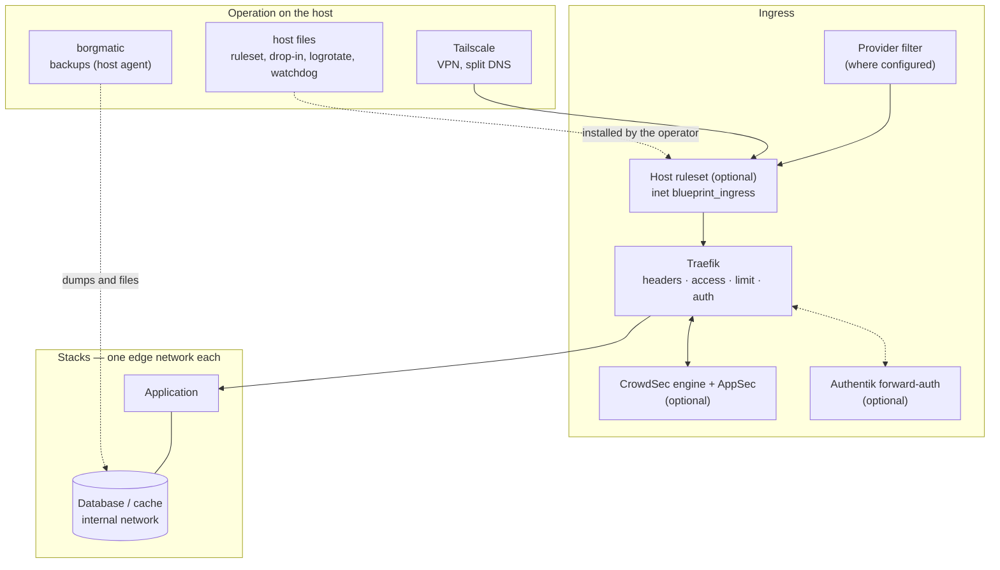
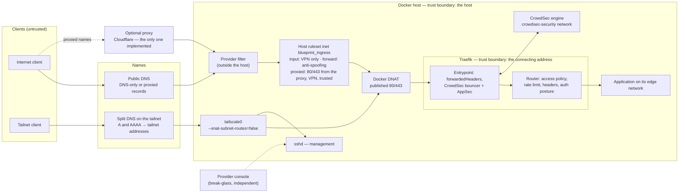
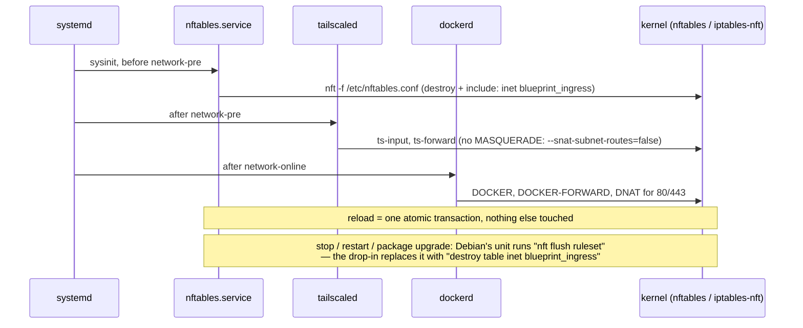
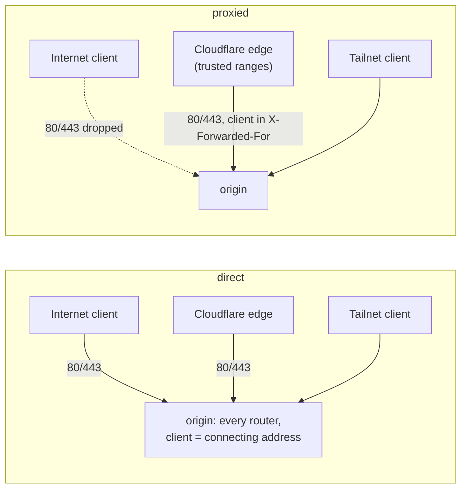

# Blueprint Architecture

Applications run as Docker Compose stacks on a Linux host. Traefik provides
shared HTTPS ingress; each application normally has its own edge network and an
isolated backend network. Host-installed components provide management, backup
and host integration. Optional identity and threat controls connect to the proxy.

Start with the overview below, then follow the question you need to answer:

- **How does a request reach an application?** [Networks](#networking-model) and
  [ingress paths and trust boundaries](#ingress-paths-profiles-and-trust-boundaries).
- **Who provides which control?** [Capabilities](#capabilities-and-reference-implementations)
  and [the application contract](#the-application-contract).
- **Where does a component belong?** [Directories](#directory-structure) and
  [conceptual domains](#physical-layout-conceptual-domains-and-navigation-are-three-different-layers).

For installation and operations, use the stack's README and the
[standards guide](standards/README.md). This page explains the system's structure,
responsibilities and limits.

---

## The installation at a glance



The diagram shows the deployment shape, not a verification level for every stack.
The host firewall, CrowdSec/AppSec and Authentik are optional layers; provider
filtering depends on the host environment. Recorded ingress tests and remaining
gaps are [summarised below](#what-is-in-place-and-how-far-it-is-proven); stack
verification is in [`LIFECYCLE.md`](../LIFECYCLE.md). The backup agent's PostgreSQL
client remains an [open decision](research/postgres-dump-client-decision.md).

---

## Networking Model

Every multi-service app uses a **hub-and-spoke** network layout. Two Docker networks per app — the edge network towards Traefik and `app-internal` behind it — plus, in a few stacks, an outbound `app-egress`:

```text
Internet / VPN
    │   host firewall, optional: config/host/ingress.nft — rendered, operator-installed (host tests: see evidence below)
    │   published ports 80/443 on proxy-public (gw_priority)
    ▼
 Traefik ──── <project>-edge (one per stack, external: true) ──► App server (web-facing)
    │         (or proxy-public, the shared choice)                      │
    │                                                    app-internal (isolated, internal: true)
    │  forward-auth middleware (optional)                               │
    ├──► Authentik (its own stack and route)     DB · Redis · Workers · internal services
    │                                                                   │
    │                                    <project>-egress (only where a named backend service needs outbound)
    │
    └─────── crowdsec-security (core-to-core, external: true) ──► CrowdSec engine
             bouncer plugin: LAPI decisions; AppSec (optional)      (AppSec rule engine: Coraza)
```

**`<project>-edge`** — one per stack, the default of every `.env.example` (`TRAEFIK_NETWORK=${COMPOSE_PROJECT_NAME}-edge`). `core/traefik` creates each network listed in `EDGE_NETWORKS` and joins it; a stack whose network is not listed is unreachable. Only Traefik and the stack's web-facing service join it, so a web container reaches Traefik and its own `app-internal`, no other front end. Owner: [`core/traefik/docs/edge-networks.md`](../core/traefik/docs/edge-networks.md), [DEC-075](../.ai/decisions.md#dec-075).

**`proxy-public`** — created by `core/traefik`; carries Traefik's published ports (`gw_priority`) and is the shared choice for stacks that reach each other by service name (Mailpit, for example). Dual-stack IPv4+IPv6 for a new installation (the example `.env` applies `network-dual-stack.yml`; DEC-063), IPv4-only without the overlay — Tailscale ingress needs it to preserve real client IPs over IPv6, where Cloudflare ingress does not (it recovers the real IP from a trusted forwarded header instead). The host runs of 2026-11-03/04 recorded preserved tailnet client addresses over both families, including after a reboot with the firewall drop-in (A1–A5, F9, T8). The admitting LAN paths and IPv6-only ingress remain unverified; these records do not re-verify later image pins ([`host-verification-ingress.md`](host-verification-ingress.md#results)). See [`core/traefik/docs/ipv6-dual-stack.md`](../core/traefik/docs/ipv6-dual-stack.md).

Two properties of this shape are measured, not assumed ([`audits/ingress-architecture-2026-10-31.md`](audits/ingress-architecture-2026-10-31.md)). Members of one Docker network reach each other's ports directly, so the four positions of the middleware model protect the path through Traefik and only that path: a compromised web container on `proxy-public` reaches every other web container on it without passing an access policy, a rate limit or a forward-auth gate. And Docker maps Traefik's published ports to its address on the network with the highest `gw_priority`, and without one to the first in Compose order — `crowdsec-security`, not `proxy-public`; since step 2 of the programme `docker-compose.yml` pins them to `proxy-public`, and an installation takes the pin on its next `docker compose up -d`. The decided direction is an edge network per installed stack, with `proxy-public` as the network that carries the published ports ([DEC-075](../.ai/decisions.md#dec-075)); it is implemented (`EDGE_NETWORKS`, step 5 of the programme), and an installation on the shared shape keeps it until it migrates ([`edge-networks.md`](../core/traefik/docs/edge-networks.md), "Moving a shared installation to edge networks"). The lateral path above remains for stacks that stay on `proxy-public`.

**`app-internal`** — one per app, `internal: true`. DB, Redis, workers. No route to the internet, no route between apps. A compromised app cannot reach another app's database. Always IPv4-only — nothing outside the Docker host connects to these services directly.

**`app-egress`** — the exception, per stack and only where a backend service must reach the outside: a plain bridge that a named service joins *in addition* to `app-internal`, for example Authentik's worker for SMTP or Nextcloud's app for federation and app updates. The database and cache never join it. A member can open any outbound connection; the stack's README states why it is there and what it needs (`core/authentik/README.md`, "Network exception"). Eleven stacks use it today — `grep -l app-egress */*/docker-compose.yml`.

**`crowdsec-security`** — a dedicated core-to-core network carrying one conversation: Traefik's bouncer plugin to the CrowdSec LAPI and AppSec engine. `core/traefik` declares it, `core/crowdsec` joins it as an external network, and no application stack joins it. The engine is on no other network, so its control-plane ports answer the reverse proxy and nothing else on the host's Docker networks. An ordinary IPv4 bridge rather than `internal: true` — the engine needs outbound access for hub updates, the Central API and blocklists. The network type and the rule for adding another are owned by [`docs/standards/networking.md`](standards/networking.md).

Traefik is the only service on both planes. Databases and caches **never** join `proxy-public` or an edge network. They have no exposure beyond their own app stack.

---

## Ingress paths, profiles and trust boundaries

HTTP requests through the shared ingress cross the layers below; which controls
apply depends on the path. Services with native protocol ports have their own
ingress, documented in their stack READMEs. This diagram shows the shared HTTPS
installation:
one Traefik per host, its ports published by Docker, Tailscale on the host itself.



Trust boundaries, from the outside in: the provider filter and the host ruleset decide
which connections reach the host; Traefik decides on the address it sees — the
connection's, or, with the proxy profile, the address the proxy reports; the access
policy, the rate limit and the auth posture are positions of each router; the
application decides on its own login. Management never crosses Traefik: SSH answers the
VPN alone once the ruleset is loaded, and the console reaches the host without either.

### Firewall, Docker and Tailscale on one host

Three parties write the kernel's packet filter, and none of them restores what another
removes. The order at boot and the stop action of `nftables.service` decide whether all
three are present:



Measured on the step 8 lab host after a reboot (T8): the blueprint table at 7.3 s,
Tailscale's rules at 18.1 s, Docker's at 18.7 s. Without the drop-in a restart of the
service left only the blueprint table (Docker and Tailscale had to be restarted); with it,
restart, the package's `try-restart` and stop/start left every other table identical
([`core/traefik/docs/host-firewall.md`](../core/traefik/docs/host-firewall.md)).

### The profiles are global

The exposure profile is derived, not set: `validate.sh` and `render.sh` read
`TRAEFIK_BIND_V4`, `TRAEFIK_BIND_V6` and `TRAEFIK_FORWARDED_PROXY` from `core/traefik/.env`
([`core/traefik/docs/host-firewall.md`](../core/traefik/docs/host-firewall.md), "The
profile"). Each of the three is one value per Traefik installation, and so is what
follows from them:

| Layer | Scope | `direct` | `proxied` |
|---|---|---|---|
| Host ruleset (`config/host/ingress.nft`) | the host | input closed but for the VPN; published ports open to everyone | the same, and new connections to the published 80/443 dropped unless from Cloudflare's ranges, the VPN or `TRUSTED_RANGES` |
| Traefik entrypoints (`forwardedHeaders.trustedIPs`) | both entrypoints, every router | nobody trusted: the connecting address is the client | Cloudflare's ranges trusted: the client is the address Cloudflare appends |
| CrowdSec bouncer (entrypoint middleware) | every router | compares the connecting address | compares the last forwarded address outside the trusted ranges |
| AppSec | every router, on or off (`CROWDSEC_APPSEC_ENABLED`) | — | — |
| Access policy, rate limit, auth posture | per router | the connecting address | the connecting address — a request through the proxy arrives from an edge address, so VPN-only routers refuse it |



**A mixed operation per application is not provided.** One installation is `direct` or
`proxied` for every router at once. With `proxied`, the forward rule refuses direct
clients for every router on the published ports — a DNS-only application stays reachable
over the VPN or a trusted range only. With `direct`, a proxied name still works (measured
on the step 8 lab host), but Traefik sees Cloudflare's edge as the client, the client's
address is only in `CF-Connecting-IP`, which nothing here trusts, and the origin is
reachable around the proxy. Per-application AppSec on and off is the same: one switch for
the entrypoint.

**Only Cloudflare is implemented as a proxy.** `TRAEFIK_FORWARDED_PROXY` accepts `none` and
`cloudflare`, and `render.sh` refuses any other value. Another proxy or CDN needs its own
ranges, its own header model and its own tests before it can be named here.

### What is in place, and how far it is proven

| | State |
|---|---|
| Edge network per stack, access policies, auth postures | implemented; tested on a host (step 8) |
| `direct` profile, dual-stack publishing, client address over IPv4 and IPv6 | implemented; tested on a host |
| Host ruleset for `direct`: input VPN-only, anti-spoofing for both families (IPv4 since 2026-11-04), persistence | implemented (rendered, installed by the operator); tested on a host — F1–F9, M1, M2, a reboot with the drop-in (T8) |
| Tailscale on the host with `--snat-subnet-routes=false`, split DNS | documented operator steps; tested on a host, both start orders and a reboot |
| CrowdSec engine, Traefik bouncer, AppSec with the shipped rule sets | implemented, optional; tested on a host, including an engine outage |
| CrowdSec's Core Rule Set | optional; measured, not recommended globally (`core/crowdsec/docs/appsec.md`) |
| A Cloudflare-proxied name beside the DNS-only zone, `direct` profile | possible; tested — edge address as client, origin not protected |
| `proxied` profile with origin protection (X4) | implemented; **tested on a host** (2026-11-04) — below |
| The headers position first on every router (refusals carry HSTS) | implemented; tested on a host |
| `nftables.service` drop-in: a restart or a package upgrade no longer flushes Docker's and Tailscale's tables | implemented (host file of `core/traefik`); tested on a host, including a reboot (T8) |
| Firewall bouncer on the host | implemented, optional; not installed on the step 8 host |
| Direct and proxied applications on one host, each with its own trust | **planned, not implemented** — below |
| Per-application or per-path AppSec | **planned** (decision of 2026-11-03), not implemented |
| Incident containment of one stack, evidence collection, controlled reconnection | **planned** — concept in [`docs/research/incident-response-concept.md`](research/incident-response-concept.md) |

### X4 — the `proxied` profile, tested

Run on the step 8 lab host on 2026-11-04, with two clients of the operator — one in the
tailnet with IPv4 and IPv6, one outside it with IPv4 only — and the host itself as a
client through Cloudflare.

What was changed, and back: `TRAEFIK_FORWARDED_PROXY=cloudflare`; a render (four files
differ: `traefik.yml`, `dynamic/crowdsec.yml`, `host/ingress.nft`,
`host/cloudflare-ranges.nft`); `docker compose up -d --force-recreate traefik`; the
ranges file and the `proxied` ruleset installed and applied with `systemctl reload
nftables`, under a timed way back. The return ran twice — once by the timer by itself,
once by hand — and both times every changed file and the blueprint table were
byte-identical to the state before.

| Check | Result |
|---|---|
| Through Cloudflare | 200 over IPv4 and IPv6, from both clients and from the host |
| Direct to the origin's 80/443, outside the allowed networks | dropped (no answer) on IPv4 (outside client) and IPv6 (the tailnet client's public path); `exposure-test.sh … proxied` exit 0 on both families; `validate.sh --strict` OK with both markers |
| Tailnet | every router answered as in `direct`, with the client's tailnet address; SSH over the tailnet only |
| The client's address | `X-Forwarded-For` at the application reads `<client>, <edge>`: Cloudflare's entry, then Traefik appends the connecting edge. The access log's `ClientHost` and CrowdSec see the client on both families. `X-Real-Ip` stays the edge address — Cloudflare sends none |
| Forged headers | from a tailnet client: ignored, the tailnet is not a trusted proxy; through Cloudflare: the forged `X-Forwarded-For` travels in the chain and in `ClientHost`, but CrowdSec's parser and the bouncer take the rightmost untrusted address — the real client (`cscli explain`) |
| A CrowdSec ban through Cloudflare | 403 after about six seconds on IPv4 and IPv6; no decision ever named a Cloudflare address; deleted, 200 again after the stream interval |
| A container calling the origin's public address | dropped in `proxied` (its source is a Docker address, not Cloudflare); answered again after the return |

Two lessons for operating it: a changed `traefik.yml` is invisible to `docker compose up
-d` — only `--force-recreate` loads it (the first attempt left Traefik trusting nobody,
and the measurement showed the edge address); and a container that reaches applications
through their public names loses that path in `proxied`.

Risks that stay: every DNS-only router is unreachable from outside the VPN for as long
as the profile is set; the trusted ranges are Cloudflare's whole network
(`core/traefik/README.md`, "What the mode cannot promise"); the access policies still
see the connecting address, so a VPN-only router is not reachable through the proxy.

### Direct and proxied side by side — a later extension

A host that serves some applications through a proxy and others directly would need the
trust to follow the path rather than the installation: a second entrypoint, or a second
address, whose `forwardedHeaders` and forward rule apply to the proxied names alone, and
routers bound to the entrypoint their names arrive on. Nothing of this is implemented; it
is recorded so that the current global behaviour is not mistaken for a per-application one.

---

## Defence in depth, where the layers differ

Layering is worth it when the layers do genuinely different jobs. For each one, four
questions have an answer: what does it observe, what does it decide, where does it
enforce, and what happens when it fails.

| Combination | Why it is not redundant |
|---|---|
| Source reputation **+** one web application firewall | reputation is cheap and catches known-bad senders; the firewall catches an unknown sender's first request |
| Reverse-proxy **+** host-firewall remediation | same decisions, different enforcement points: one sees the request and can explain the refusal, the other acts before a connection exists and covers ports the proxy never handles |
| Reputation/behaviour **+** passive network IDS | logs and packets are different evidence — but only if someone reads the alerts |

Two engines doing the *same* job at the same point is not depth. Two inline web
application firewalls means twice the inspection, two rule sets to tune, and a block from
one hiding the other.

---

## Capabilities and reference implementations

The blueprint is a set of **capabilities**. Each one answers a security or operational
question on its own, and each has at most one maintained **reference implementation** —
the product this repository actually configures, tests and documents.

The distinction matters because it separates two questions that are easy to conflate:
*does my deployment need this capability?* and *which product provides it?* The first is
architectural, the second is replaceable.

| Capability | Question it answers | Reference implementation | Status |
|---|---|---|---|
| **Foundation** | how does this host run containers safely at all? | the standards in `docs/standards/` | prerequisite |
| **Reverse Proxy** | how does a request reach the right service, over TLS, under a policy? | Traefik (`core/traefik/`) | implemented |
| **Identity & Access** | who is allowed to use this service? | Authentik (`core/authentik/`) | implemented, per app |
| **Threat Detection & Remediation** | which sources are known bad, and where is that enforced? | CrowdSec (`core/crowdsec/`) | implemented |
| **Web Application Security** | is *this request* an attack, regardless of who sent it? | CrowdSec AppSec — its rule engine is Coraza, inside CrowdSec; shipped with virtual-patching and generic rules, no OWASP Core Rule Set | implemented, opt-in, fail-open as shipped |
| **Network Security / IDS** | what is happening on the wire that no log records? | — | candidate, not implemented |

Capabilities are independent. Integrations connect them, and an integration is named,
documented and owned. CrowdSec is not a Traefik feature; Authentik is not a proxy layer;
a web application firewall is not the same control as blocking a source address.

**One maintained implementation per capability.** Alternatives may be documented without
being implemented — that keeps the maintenance surface bounded. Three states are kept
apart deliberately:

| State | Meaning |
|---|---|
| **implemented** | configured, documented and exercised in this repository |
| **documented alternative** | described so a fork can choose it; not maintained here |
| **evaluation candidate** | under consideration; no claim of support |

SIEM, XDR and SOC platforms are outside this blueprint. They carry a different operating
model — agents, central collection, an analyst rota — and a secure Docker host does not
require one.

---

## Foundation

Foundation is the substrate. It is what a host needs before any of the capabilities above
make sense, and it does not know which of them are installed.

| Part | Owns | Canonical source |
|---|---|---|
| **Host** | the prerequisites a Docker host must meet — a supported and patched system, management access that is not the public attack surface, a host firewall policy, working time and name resolution, and enough capacity held back for management and recovery | thin, see below |
| **Docker** | privileges, capabilities, socket access, image pinning | [`standards/security-baseline.md`](standards/security-baseline.md) |
| **Network** | hub-and-spoke layout, isolation, which service belongs on which network | [`standards/networking.md`](standards/networking.md) |
| **Secrets** | file-based credential delivery and documented environment exceptions | [`standards/security-baseline.md`](standards/security-baseline.md) |
| **Backup** | what is protected, from what, and how a restore is proven | [`../backup/README.md`](../backup/README.md) |
| **Image provenance** | where a deployable image comes from, and what pins it, when this repository builds it rather than pulling one | [`standards/custom-application.md`](standards/custom-application.md) |
| **Updates** | version pinning and the upgrade path per stack | each stack's `UPSTREAM.md` |
| **Lifecycle** | what has been established about each stack | [`standards/status-model.md`](standards/status-model.md) |

**Host is deliberately thin.** It owns generic invariants — a management path should not be
reachable the same way the public service is; a host firewall policy exists and someone
owns it. It is not configuration management, and not a hardening distribution.

A service may *implement* a Host invariant through an integration. CrowdSec's host-firewall
remediation is one: it enforces decisions in the host firewall, within a scope the Host
policy defines. It does not become the host firewall policy. Designed and optional; its
blocking rules have not been run on a host.

`core/traefik` renders a host-firewall ruleset for its exposure profile
(`config/host/ingress.nft`, [`core/traefik/docs/host-firewall.md`](../core/traefik/docs/host-firewall.md),
DEC-078): it closes the host's input path except for the VPN and leaves Docker's forward
path open. The operator installs it; nothing in the repository loads it automatically.
The 2026-11-03/04 host tests covered the ruleset, persistence and VPN access;
[the evidence and its limits](host-verification-ingress.md#results) remain separate
from verification at later image pins.

### Workload pressure must not consume what recovery needs

**A host under load from its own workloads has to stay administratively reachable.**
Losing an application is an incident; losing the ability to log in, read logs and stop
the offending container turns it into an outage that ends with a power cycle.

Container-level limits bound each workload, and that is where most of the protection
lives — a service reaching its own ceiling fails alone. What they do not do is reserve
anything: nothing in a per-container limit keeps memory available for the trusted
management path, the container runtime, logging, or the tools used to stop a workload.
On a default host, management services and container workloads compete in the same
place.

The invariant is Foundation's:

> Enough host capacity remains available for management and recovery that an operator
> can always reach the machine, see what is happening, and stop the workload causing it.

The mechanism is **not decided**. The candidate is a separate cgroup hierarchy for
container workloads with memory protection on the slice holding management services —
the kernel supports it, and the interfaces are stable. It is not a default here, and
it is not installed anywhere, because it has not been rehearsed: a protection that has
never been tested under real pressure is an assumption.

What a rehearsal has to establish, on a disposable host:

1. container workloads land in the intended hierarchy, and management services do not;
2. controlled memory pressure inside a container reaches that container's boundary;
3. the trusted management path stays usable throughout;
4. the container runtime stays administratively usable;
5. logs remain readable;
6. the offending workload can be stopped;
7. what happens when the reserve mechanism itself is absent or misconfigured.

Until that has run, the invariant is documented and the enforcement is per-container.
Products are examples: a VPN, an SSH daemon and a container runtime are roles, and a
deployment may fill them differently.

---

## Exposure decides which controls apply

A control is not chosen by working through a list in order. It follows from what a
deployment actually exposes.

| Classification | Meaning |
|---|---|
| **Prerequisite** | without it the system does not run safely — Foundation, and a reverse proxy for the shared HTTPS ingress |
| **Exposure-driven control** | warranted because a specific exposure exists, and largely pointless without it |
| **Optional enhancement** | real value, not implied by every deployment |
| **Advanced** | higher operational cost, tuning burden or blast radius |

Worked through:

- A service that terminates **on the host** and is reachable from the internet is not
  behind the reverse proxy — the proxy never sees it. Protecting it is a host firewall
  question, and CrowdSec's host-firewall remediation is the relevant control. Whether any
  such service is exposed at all is a Host/Foundation decision first.
- A public **HTTP application behind the reverse proxy** is covered by reverse-proxy
  remediation. That does not require host-firewall remediation.
- **Management access over a private path** does not remove the need for either, but it
  does constrain them: an enforcement rule must not be able to reach the management path.
  That is an invariant, independent of which VPN or interface a deployment uses.

Both CrowdSec remediation points may run together. They enforce at different places and
see different things. Running both is a choice, not a requirement.

---

## One owner per piece of changing state

**A changing security state has exactly one canonical owner.** Other components may read
it; they do not write it.

| State | Owner |
|---|---|
| Firewall tables, sets and enforcement chains | the blueprint's own firewall integration |
| Membership of a blacklist set | the remediation component that maintains it |
| Threat decisions | the detection engine's API |
| Exemptions that must hold regardless of decision origin | the engine's allowlist mechanism |
| Routing, middleware chains, certificates | the reverse proxy |
| Application configuration, secrets and volumes | the application |

Where two tools would write the same state, one of them is wrong. That is the test to
apply before adding a second product to an existing capability.

---

## The application contract

An application **consumes** capabilities. It does not contain them.

An application may assume:

- a network exists on which a reverse proxy can find it;
- routing metadata it declares is honoured;
- named middleware — access policy, security headers, threat enforcement — can be
  referenced by name;
- secrets arrive as files by default; documented environment exceptions follow
  [the security baseline](standards/security-baseline.md#secrets);
- its logs are readable by security tooling.

An application is expected to provide:

- a way to run it without a reverse proxy at all, for local use;
- a healthcheck;
- the Foundation baseline;
- a documented `.env.example`.

An application must not:

- contain a reverse proxy, a detection engine or an identity provider;
- create a shared proxy or control-plane network;
- define global middleware;
- depend on an infrastructure container's lifecycle unless it genuinely requires it.

For the shared HTTPS ingress, an application consumes the reverse-proxy capability;
Traefik is its implementation here. Native protocol ports follow the stack's own
exposure model. Many stacks also provide a local Compose file that runs without
a proxy.

---

## Design Goals

- **Fork-ready**: Clone, copy `.env.example` to `.env`, fill secrets, `docker compose up -d`. No undocumented prerequisites.
- **Portable**: Supported Linux hosts share the documented [deployment prerequisites](standards/deployment-lifecycle.md#1--prepare-the-host). Host integration is explicit: Borgmatic, optional watchdogs and host files have their own installation steps and permissions. The [backup design](../backup/README.md#where-the-backup-agent-belongs) explains the host-agent choice; the [host-file standard](standards/host-files.md) covers installed rulesets, units and log rotation.
- **Security-first**: Hardening is the default. Relaxing a control requires a documented exception.
- **Standards-consistent**: Every service follows the same compose structure, env layout, secrets pattern, and naming convention. A new app that follows the standards fits in without friction.

---

## Core Services and Their Roles

`core/` holds capabilities whose scope is the installation rather than one stack:
control of Docker, the host or other containers, and shared network, TLS, identity,
DNS, security or secrets. A member may be optional, and two members may be
alternatives to each other — optionality does not disqualify a capability, because
scope is what the category is about. It is a scope and privilege category, not the
capability model; which capability each service implements is the table
[above](#capabilities-and-reference-implementations).

Grouped by role, every member accounted for:

| Role | Members | Why it is in `core/` |
|---|---|---|
| Request path | Traefik (with its socket proxy), CrowdSec | Terminates TLS and reaches every routed container; the socket proxy keeps the Docker socket off services that only need container metadata; CrowdSec reads logs across stacks and its decisions are enforced elsewhere |
| Shared identity | Authentik (reference implementation), Keycloak (maintained alternative) | An identity provider several applications authenticate against |
| Shared names and certificates | dnsmasq, acme-certs | Resolves names for the installation; issues certificates for the devices that never pass through Traefik |
| Shared secrets | Infisical | Optional central alternative to per-stack Docker Secrets — it holds other stacks' credentials |
| Docker control plane | Dockhand + Hawser, Portainer + Portainer Agent | Control the Docker daemon, locally or on remote hosts; each pair is a UI plus its agent |

The socket proxy is a service inside `core/traefik`, not a directory of its own.
`acme-certs` is being extracted to its own repository ([`ROADMAP.md`](../ROADMAP.md)) —
a maintenance decision, not a classification one.

---

## Directory Structure

Five top-level categories, split by **how** each tool accesses the system — not by who uses it:

| Directory | Responsibility | Access pattern |
|---|---|---|
| `core/` | Shared platform and control plane — capabilities scoped to the installation, not to one stack | Privileged or cross-stack — controls Docker, the host or other containers, or serves a capability other stacks route through, authenticate against, resolve names with, or store secrets in |
| `apps/` | User-facing applications | Standard — Traefik-routed, DB + volume access |
| `business/` | Business operations tools | Standard — same pattern as `apps/`, distinct operational scope |
| `monitoring/` | Observability and alerting | Cross-stack — reads metrics and logs from other containers |
| `backup/` | Data protection | Privileged — reads volumes across services, writes to remote targets |

`monitoring/` and `backup/` are top-level (not under `apps/`) because their access patterns are fundamentally different: they reach across service boundaries and need broader permissions than a typical user-facing app.

**Which category does a new service belong to?** One test question each, applied in order:

| Directory | Test |
|---|---|
| `core/` | Does it control Docker, the host or other containers, or does it provide a shared network, TLS, identity, DNS, security or secrets capability for the installation rather than for its own users? Scope decides, not dependency: a member may be optional, and two members may be alternatives to each other. |
| `monitoring/` | Does it observe one or more other services? |
| `backup/` | Does it protect data belonging to other services? |
| `business/` | Is a company needed for this to be useful at all? (issuing invoices, customer helpdesk, compliance) |
| `apps/` | Everything else — would a homelab user *and* a company both use it? A stack that serves its own users belongs here, including a diagnostic fixture deployed to prove another stack works: that is a lifecycle property, and no category test asks about lifecycle. |

The access-pattern test determines physical placement; a reader-facing topic can
group stacks from several directories without moving them. This distinction
addresses an earlier classification attempt: placing `business/` by analogy to
`monitoring/` left ten existing applications without a consistent home. The
access-pattern test explains both their placement and why navigation may group
them differently.

---

## Physical layout, conceptual domains and navigation are three different layers

Directory layout, conceptual grouping and website navigation answer different
questions. Each has its own owner and reason to change:

| Layer | Question it answers | Owner | Changes when |
|---|---|---|---|
| **Physical layout** | how does a stack access the system? | this document, the five directories | a stack's access pattern differs from every existing category |
| **Conceptual domain** | how does a reader group this in their head? | documentation, `.ai/decisions.md` | a subject-matter grouping helps a reader, independent of any directory |
| **Website navigation** | how does a reader find this? | `site/` | reader research shows a different grouping helps — already independent today, see the site's Infrastructure/Applications/Operations split |

The physical layout is `core/apps/business/monitoring/backup`, unchanged, and is
the only one of the three that CI knows about at all: `check-structure.py` and
`check-coverage.py` enforce that every stack sits under one of the five roots and
that no root goes unchecked. Which of the five a given stack belongs in is a
judgement against the table above, not something CI can decide. A conceptual
domain can exist purely as documentation
and navigation vocabulary, with no stack in it, for as long as that stays
useful to a reader — it earns a directory the same way any category does: by
failing every test in the [Directory Structure](#directory-structure) table.

**Conceptual domains today**, alongside the five that already map to a
directory (Infrastructure → `core/`, Applications → `apps/`, Business →
`business/`, Monitoring → `monitoring/`, Operations & Recovery → `backup/`):

- **Development / Custom Applications** — has a physical home, `development/`,
  for the patterns it owns. See below.
- **AI & Local AI** — deployable services, in `apps/`; the engineering above them is not this repository's. See below.
- **Document Processing** — real capabilities plus one standalone service; still no orchestrated pipeline. See below.

AI & Local AI and Document Processing do not justify a new top-level directory.
Development has one, for a different reason than the access-pattern test the
five categories use — see below.

### AI & Local AI is deployment, not engineering

The line runs between running a service and doing the engineering. Deploying
and hardening a reusable AI service — a model runtime, a gateway, a vector
store — is this repository's problem, and it goes through the same
categorisation test as anything else: nothing about "AI" changes which
directory it lands in, and an observability component for it would most likely
be `monitoring/`. The engineering above that line — model evaluation,
retrieval architecture, prompt design, the experiments that decide whether any
of it is worth running — belongs to a different project and is not served by
putting a Compose file here.

The first services are in `apps/`:

| Part | Where it lives |
|---|---|
| Model runtime, simple, runs on CPU | `apps/ollama` |
| Model serving, high throughput, NVIDIA GPU | `apps/vllm` |
| Vector database | `apps/qdrant` |
| Gateway with virtual keys and budgets | `apps/litellm` |
| Chat interface | `apps/open-webui` |
| LLM and MCP gateway | `apps/agentgateway` |
| LLM application platform | `apps/dify` |
| LLM observability | `monitoring/langfuse` |

Ollama and vLLM both serve models and are both kept: they cover different
deployments — one runs on any machine and pulls models by name, the other needs
a GPU host and is built for concurrent load. Neither depends on the other or on
Qdrant, and each is usable on its own.

LiteLLM and agentgateway are both gateways and are both kept: LiteLLM adds
virtual keys, budgets and a spend log in PostgreSQL, agentgateway is a single
distroless binary that also routes MCP. Open WebUI is a chat interface. None of
them requires another: each takes an OpenAI-compatible endpoint from its
configuration, and any of the model servers above, or a hosted provider, can sit
behind it. Pointing one at another is an operator's choice, not something the
stacks assume.

Dify is an application platform whose model providers are plugins, so it too takes
its backend from its own console rather than from the stack. Langfuse is an
observability service and sits in `monitoring/`: it receives traces from whatever
instruments its code with an SDK or OpenTelemetry, and none of the other stacks
sends to it or requires it.

Two properties of these services shape the stacks. Ollama has no authentication, and vLLM's `--api-key` protects only
its `/v1` paths, so the reverse proxy is the real access control — vLLM's route
forwards `/v1/` only. And the model servers need outbound access to fetch weights, so their single
service sits on the stack's proxy network — the edge network `<project>-edge` by
default, a plain bridge with outbound access — rather than on an `internal`
network; Qdrant ships the same way. A stack that consumes one of them by service
name (no shipped stack does) needs both on the shared `proxy-public` instead;
otherwise it reaches them through their route. Each
stack's own README states what was verified; vLLM's CUDA image has not been run
on a GPU here.

Machine learning also runs inside Immich and PhotoPrism as a property of those
applications, which is not a separate domain.

### Document Processing has the capabilities, and one standalone service

The domain is real and covered in four parts:

| Part | Where it lives |
|---|---|
| Archive and ingest — OCR, indexing, search | `apps/paperless-ngx` |
| Browser-based editing | `apps/onlyoffice`, `apps/euro-office`, `apps/collabora` |
| Electronic signature | `business/documenso`, `business/opensign` |
| Document understanding for AI/RAG pipelines — layout, structure, tables | `apps/docling-serve` |

Apache Tika and Gotenberg still belong to Paperless-ngx as its own converters,
not as shared services other stacks call — `docling-serve` landing did not
give either a second consumer, so this is unchanged. `docling-serve` earns a
standalone stack for a different reason: layout-aware document understanding
for AI pipelines had no home in this repository at all, and multiple plausible
callers (a workflow tool, a future RAG stack) exist for it, where Tika and
Gotenberg still have exactly one.

A general document-processing pipeline — one orchestrated path from any input
document through every possible extraction step — still does not exist.
`docling-serve` is one capability, consumed directly by whatever calls its
API; it is not that pipeline. Building an orchestrated multi-step chain before
a real case needs one remains the deliberate absence this section described
before docling-serve existed.

OCRmyPDF was evaluated for a standalone stack and excluded. Upstream describes
its own Docker image as ephemeral — one container per OCR job, exiting like a
command-line program, not a server — and this repository does not give a
CLI/job tool with no independently operated service a blueprint entry. See
[`ROADMAP.md`](../ROADMAP.md#out-of-scope-here).

### Development is a Supporting-tier domain, not a sixth category

The mission covers two kinds of software: existing self-hosted open-source
projects, and applications someone builds themselves. Both go through the same
**deploy → secure → operate → recover** model, but the first phase differs — an
existing project starts from a published, versioned image; software someone
builds starts from source and a build step, which
[`standards/custom-application.md`](standards/custom-application.md) owns.

**This is not what `docker-compose.local.yml` is for.** The local test stack
([`standards/compose-structure.md`](standards/compose-structure.md)) is a
deployment mode of an already-packaged application — the same `image:` tag,
published without Traefik, DNS or a certificate so it can be tried on one
machine. It answers "how do I try this app," not "how do I harden an app I
wrote."

[`development/`](../development/) is where the build phase lives as a reusable
artifact. `development/static-site/` and `development/web-api/` are complete,
working deployment shapes — a real build, a real hardened runtime, a
local-validation compose file, each proven by a minimal fixture — that a real
project copies into `apps/` or `business/` under its own name once it exists.
They are never deployed from inside this repository, and they are not stacks
in the access-pattern sense the five categories use: the [Directory
Structure](#directory-structure) test asks how a running service reaches the
system, and a pattern that is never run here has no access pattern to test.
That is also why `development/` does not become a sixth category — it sits
alongside `docs/`, `scripts/ci/` and `site/` as a Supporting-tier directory,
checked by [`scripts/ci/check-structure.py`](../scripts/ci/check-structure.py)
anyway, because unlike those three it holds real, buildable compose files
worth the same structural and security check any stack gets.

Existing examples show two image-build shapes:
`business/vikunja` adds a layer to a published image because upstream ships
`FROM scratch`, and `apps/caldiy` consumes a governed fork's reviewed release.
[`standards/custom-application.md`](standards/custom-application.md) is derived
from those two — it covers source, build, image identity and what verifies the
image, and states that every phase after the image is unchanged. `development/`'s
patterns are a third shape built on the same standard: a reusable starting
point with no concrete application behind it yet, adopted by copying rather
than by reference.

`apps/_reference` still templates the hardening pattern around a pre-built,
versioned image — its `UPSTREAM.md`, its `_FILE`-secret assumptions and the
Trivy scan target all presume one. `development/`'s patterns hand off to it:
once a project copied out of `development/` has its own identity, everything
after the image — configuration, networking, backup documentation — follows
`apps/_reference`'s structure exactly like any other stack.

These patterns also give first-party applications — source with no upstream
project — a starting point. Vikunja and Cal.diY wrap third-party software; the
patterns address the separate need to harden and deploy an application someone
writes themselves. They were introduced for that reusable need, rather than for
one specific application. This supersedes the earlier decision to leave the
shape absent until a concrete application needed it; the
[decision record](../.ai/decisions.md) retains that history, and
[`standards/custom-application.md`](standards/custom-application.md) owns the
current requirements.

---

## Per-App Structure

Every app follows the same directory layout regardless of category:

```text
<category>/<app>/
├── docker-compose.yml   # hardened, standards-aligned
├── .env.example         # all variables documented inline, no real values
├── .gitignore           # volumes/, .secrets/, .env
├── README.md            # setup steps, verify commands, architecture notes
├── UPSTREAM.md          # upstream image, changelog link, license
├── .secrets/            # gitignored — generated locally per install
└── volumes/             # gitignored — persistent application data
```

**Config lives in Git. Secrets and data never do.**

The compose file and `.env.example` are the portable artifact. The `.env`, `.secrets/`, and `volumes/` are per-installation and stay on the host.

---

## Backup Design Principle

Backup is cross-cutting by nature — it reads from every data-producing service. The blueprint's approach:

- **One host-level configuration covering everything is the starting point.** Separate repositories per app give independent retention, surgical restore and independent failure — and they multiply the configurations, schedules and restore rehearsals. A rehearsal that is never run protects less than a shared repository that has been restored from. The procedure and the split rule are owned by [`backup/README.md`](../backup/README.md) → *Per-app separation — an option, not a rule*.
- **An app is split out when its data demands it** — a retention requirement that differs from the rest (a database with daily backups and 90-day retention beside a static site backed up weekly), or data large enough that the shared schedule stops working. Borgmatic supports several configuration files for exactly this.
- **Restoring one app does not touch another's data** in either layout: a restore extracts that app's source directories and database dump from an archive.
- **A shared repository shares its exposure.** A compromised target or key reaches every app in it; the controls are the key kept off the backed-up host and the append-only remote described in `backup/README.md`.

See [`backup/README.md`](../backup/README.md) for tool choices and the picking matrix.
