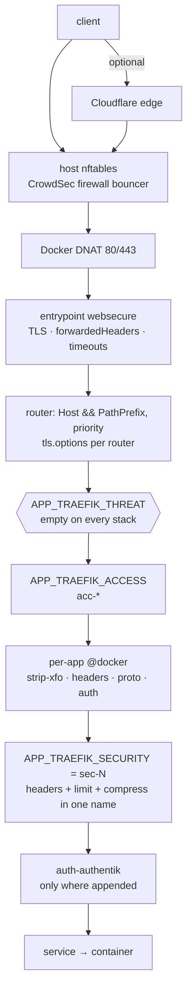
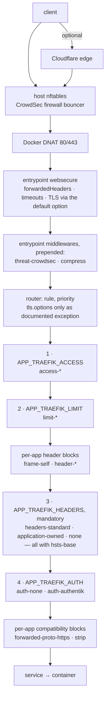

# Traefik security architecture — as it is, and as decided (2026-10-18)

**Status: architecture review, decided; applied as Phase 4.3 (PR #258), kept as the record of the analysis and the lab proofs.** Revision 3
of the review begun on 2026-10-17: revision 2 worked in decisions D1–D8; this
revision adds the local lab proofs of 2026-10-18 (Part A, file provider only;
Part C, four applications; the forged-header test; record outside the
repository), the three decisions taken on them — TLS variant A, HSTS form H2,
compression exclusions — and the header-profile assignments of the four
measured applications. The eight architecture decisions D1–D8 of
2026-10-18 and their precisions are worked into every section; the earlier
"questions to decide" are replaced by section 9 (what is decided) and
section 10 (what is open). No implementation plan, no pull-request split, no
change to templates, stacks, `.env.example` files or CI rules is attached.
Nothing here is verified on a host; the thirteen Phase 3 host checks stay open
and are carried in section 8.5.

Evidence classes used throughout: **measured** (a number from a host or a
throwaway backend, recorded in the repository), **documented** (a stack's README
or `.env.example` states the need, no measurement on record), **assumed** (a
reading of the configuration that nothing confirms). **Rename** marks a change
that keeps today's behaviour under a new name; **behaviour change** marks one
that does not.

## 1. Inventory

### 1.1 What was read

Every `docker-compose.yml` and every additional Compose file under `apps/`,
`business/`, `core/` and `development/` (the Seafile stacks carry routers in
five overlay files each, Ghost's ActivityPub in one), every `.env.example`,
every stack README for the words that mark a requirement (iframe, embed,
websocket, sync, webhook, upload, mobile, 429, rate limit, SSO, forward-auth),
the Traefik templates of `core/traefik`, the standards `traefik-security.md` and
`traefik-labels.md`, `scripts/ci/check-structure.py`, the five Traefik test
modules, the bugfix records (Keycloak frame header 2026-09-07, Authentik
forward-auth 2026-05-03, IPv6 dual-stack 2026-06-19), the limits evaluation of
2026-09-23, the CHANGELOG entries on `429`, `.ai/state.md`'s chain notes, the
three Phase 3 reviews under `docs/reviews/`, and the Traefik v3.7.0 reference
for entrypoints (`docs/content/reference/install-configuration/entrypoints.md`
at tag v3.7.0). The extraction script and its JSON are in the session
scratchpad, not in the repository.

### 1.2 The numbers

| Count | What |
|---|---|
| 119 | stacks with an `.env.example` |
| 92 + 2 | stacks with Traefik routers in `docker-compose.yml`, plus Seafile and Seafile Pro (routers in overlays); Ghost adds one router in `activitypub.yml` |
| 110 | HTTP routers; no TCP or UDP router; every router on `websecure` |
| 94 | routers with a plain `Host()` rule; 16 with `Host() && PathPrefix()` or a second host name — the secondary routers |
| 13 | stacks with an `.env.example` and no router: the mail servers, CrowdSec, dnsmasq, step-ca, Teleport, the Portainer agent, Velociraptor, OpenCanary, the certificate stack, Traefik itself |
| 9 | stacks that define a Docker-provider middleware of their own |
| 4 | routers that write a chain literally instead of through `APP_TRAEFIK_SECURITY` |

### 1.3 How the routers are configured today

**Access policy** (`APP_TRAEFIK_ACCESS`, the operator's choice): `acc-tailscale`
66 · `acc-public` 28 · `acc-private` 14 · `acc-local` 1 (`core/headscale`) ·
`acc-deny` 1 (`apps/windmill`, ships closed).

**Security chain** (`APP_TRAEFIK_SECURITY` — headers, limit and compression
under one name):

| Value | Stacks | Headers | Limit | Evidence for the value |
|---|---|---|---|---|
| `sec-2` | 49 | HSTS 2y, nosniff, frame DENY | 125/s, burst 200 | the generic default; no stack gives a reason |
| `sec-3` | 36 + 1 literal | + includeSubDomains, preload, Referrer-Policy, CSP report-only, Permissions-Policy | 125/200 | "public-facing and hardened" — a category |
| `sec-2-spa` | 5 | as `sec-2` | 125/500 | **measured**: Open WebUI 173 requests (65 × `429` under 200), Dify >160, CISO Assistant 225 (14 × `429`), Immich ~100 service-worker fetches; Keycloak documented |
| `sec-3-spa` | 5 | as `sec-3` | 125/500 | **documented**: NocoDB, n8n "100+ chunks", OpenSign, Dockhand, Infisical — no numbers |
| `sec-2-spa-xl` | 2 | as `sec-2` | 125/1000 | **measured** 2026-09-23: Twenty 505–516, Windmill 389–857 requests, no `429`, five loads each |
| `sec-2-sync` | 2 | as `sec-2` | 1000/1000 | **measured**: Seafile clients, one request per block, three threads each way — the sustained rate caused `429` |
| `sec-3e-sync` | 1 | `sec-3` with SAMEORIGIN, `Referrer-Policy: same-origin` | 1000/1000 | **measured** for the sync (Nextcloud desktop client, 20 parallel); **documented** for SAMEORIGIN |
| `sec-2e` | 1 | `sec-2` with SAMEORIGIN | 125/200 | **documented**: listmonk's campaign preview in an iframe of its own admin UI |
| `sec-4` | 3 | as `sec-3` | 20/40 | Adminer and ntfy **assumed** ("admin tools"); Portainer **measured** (first load fits, issue #37) |
| `sec-5` | 1 | `sec-3` + enforcing CSP | 20/40 | whoami, static — **documented** |
| `sec-3e` | 1 literal | as `sec-3e-sync` headers | 125/200 | Vaultwarden with a `strip-xfo` in front; "not verified on a host yet" |
| `sec-1` | 2 (1 literal) | headers, no limit | none | Authentik's main and `/_static/` routers |
| `sec-0`, `sec-1e`, `sec-3e-spa` | 0 | | | defined, selected by nothing |

**Threat enforcement** (`APP_TRAEFIK_THREAT`): 62 `.env.example` files carry it,
all empty; 38 routers lack the slot (audit TD9); the value, when set, is
`crowdsec-basic@file,` with the comma inside. No stack ships the bouncer on a
router.

**TLS profile** (`APP_TRAEFIK_TLS_OPTION`): `tls-aplus` 97 · `tls-modern` 7
(Vaultwarden and six `core/` consoles: Dockhand, Portainer, JumpServer,
Orion-Belt, ShellHub, Warpgate) · `tls-basic` 6 (Nextcloud, whoami, WordPress,
Shlink, Vikunja, OpenProject). Only Shlink states a reason ("until the consumer
is known"); the other five are **assumed**.

**Authentication gate:** no stack ships a forward-auth middleware on a router.
`core/traefik` renders `auth-authentik` under `AUTHENTIK_FORWARD_AUTH_ENABLED`;
the integration was tested live on 2026-05-03 (Dashy, Heimdall, Paperless-ngx
`/admin`); Paperless-ngx's `-admin` router is commented out today. Authelia's
README shows a hand-written `forwardAuth`. Paperless-GPT carries HTTP basic auth
as a Docker middleware; Vikunja carries a `/login` redirect to its SSO provider.

### 1.4 The secondary routers — all sixteen

| Stack | Router | Rule | Middlewares today | Serves | Shape |
|---|---|---|---|---|---|
| `apps/ciso-assistant` | `-api` | `/api` | threat, access, chain | backend of the same UI | API, same origin |
| `apps/dify` | `-api` | seven prefixes (`/console/api`, `/api`, `/v1`, `/files` …) | threat, access, chain | API | API, same origin |
| `apps/shlink` | `-api` | `/rest` | threat, `APP_TRAEFIK_API_ACCESS`, chain | REST API with its own policy | API, own policy |
| `apps/shlink` | `-client` | own host | threat, `CLIENT_TRAEFIK_ACCESS`, chain | web client | UI, own policy |
| `apps/dependency-track` | `-api` | own host | threat, access, chain | API on its own host name | API, own host |
| `apps/agentgateway` | `-ui` | own host | threat, `AGW_UI_TRAEFIK_ACCESS`, chain | admin UI beside a gateway | UI, own policy |
| `business/opensign` | `-api` | `/app` | access, chain | API | API |
| `business/erpnext` | `-socketio` | `/socket.io` | threat, access, chain | websocket | websocket |
| `core/authentik` | `-static` | `/_static/` | access, `sec-1` literal | static assets, no limit | static |
| `apps/seafile`, `apps/seafile-pro` | `-notification` | `/notification` | access only | notification server, long-lived | push |
| `apps/seafile`, `apps/seafile-pro` | `-seadoc-ws` | `/socket.io/` | access only | websocket | websocket |
| `apps/seafile`, `apps/seafile-pro` | `-seadoc` | `/sdoc-server` | access, `seadoc-strip@docker` | document server | API |
| `apps/seafile`, `apps/seafile-pro` | `-thumbnail` | `/thumbnail` | access only | thumbnails | static |
| `apps/ghost` | `-ap` | `/.ghost/activitypub`, `/.well-known/webfinger` … | access, chain, `-ap-proto@docker` | ActivityPub | API, federation |
| `apps/paperless-ngx` | `-admin` (commented out) | `/admin` | access, chain, `auth-authentik` | the one documented path behind the gate | admin path |

### 1.5 The per-stack middlewares

| Stack | Middleware | Does | Why |
|---|---|---|---|
| `apps/collabora`, `apps/euro-office`, `apps/onlyoffice` | `-proto`, `-headers` (three identical copies) | sets `X-Forwarded-Proto: https` and `X-Forwarded-Host`; sets nosniff, HSTS, `browserXssFilter`, an own CSP | the office servers require the proto header and ship their own header set; no `sec-*` chain, no limit |
| `apps/paperless-ngx`, `business/matomo` | `-headers` | `X-Forwarded-Proto/Host` | URL derivation |
| `apps/vaultwarden`, `business/matomo`, `core/keycloak` | `-strip-xfo` | removes the chain's `X-Frame-Options` | the application sets its own; **measured** for Keycloak, documented for the others; works only ahead of the chain |
| `apps/paperless-gpt` | `-auth` | HTTP basic auth | no login in the application |
| `business/vikunja` | `-sso-redirect` | `/login` → SSO | SSO-only mode |
| `apps/ghost` | `-ap-proto` | `X-Forwarded-Proto: https` | federation signatures |
| `apps/seafile*` | `seadoc-strip` | strips `/sdoc-server` | the server expects the root |

Traefik's entrypoint already sets `X-Forwarded-Proto` and `X-Forwarded-Host` on
every request (`forwarded_header.go`, `rewrite`); whether the five hand-set
copies are redundant or work around an application's trusted-proxy setting is
not recorded — **assumed** redundant, to be checked.

### 1.6 Documented special cases, by requirement

| Requirement | Stacks | Evidence |
|---|---|---|
| Frames its own pages, sets no frame header | listmonk | documented |
| Sets its own frame header | Keycloak (measured: SAMEORIGIN + `frame-ancestors 'self'` on the console, nothing on the 3p-cookie and status-iframe pages), Vaultwarden, Matomo, Nextcloud ("requires SAMEORIGIN"), the three office servers | measured once, otherwise documented |
| Sets its own referrer policy | Keycloak, Nextcloud (`no-referrer`, per `.ai/state.md`) | documented |
| Is embedded by another stack | the four dashboards frame other stacks; the standard asks the target for a `frame-ancestors` naming the dashboard's origin — no stack ships one | documented, unsolved |
| First load above 200 requests | Open WebUI 173, Langfuse 152, LiteLLM 160, Dify >160, CISO 225, DefectDojo 120, ERPNext 126, Chatwoot 84, Akaunting 38 — all under 500; Twenty 412–516 and Windmill 389–857 above | measured |
| Sync clients bounded by the sustained rate | Nextcloud, Seafile, Seafile Pro | measured |
| Mobile apps | Immich (measured), Nextcloud, Paperless-ngx, Vaultwarden | documented |
| Websocket, SSE, long-lived | ERPNext socket.io, Seadoc socket.io, Seafile notification; DFIR-IRIS, Chatwoot, Plausible, Zammad (READMEs); the AI stacks stream responses (Ollama, vLLM, LiteLLM, Open WebUI, Dify) | documented |
| No login of its own | Ollama (README names forward-auth), Paperless-GPT (basic auth) | documented |
| Admin path inside an open application | Paperless-ngx `/admin` | measured 2026-05-03, router commented out |
| Static, CSP-tested | whoami | documented |
| Second host name with its own policy | Shlink client, Agentgateway UI, Dependency-Track API | configured |

Not in the inventory: a measured response-header set of any application
**without** the proxy. Every "sets its own headers" is a README sentence or a
bugfix; the Keycloak frame header is the one measured case.

## 2. The architecture as it is

### 2.1 The request path — technical order

```text
 client ─┬─ Cloudflare edge (TRAEFIK_FORWARDED_PROXY=cloudflare) ─┐
         └─ direct: LAN, VPN, Internet ───────────────────────────┤
                                                                  ▼
 host nftables ── CrowdSec firewall bouncer (set-only, forward hook): drops banned addresses
                                                                  ▼
 Docker DNAT :80/:443 → Traefik (proxy-public)
                                                                  ▼
 ENTRYPOINT web :80 ── redirection → websecure
 ENTRYPOINT websecure :443
   TLS handshake: certificate (resolver / wildcard); options from the matched router
   forwardedHeaders: X-Forwarded-* and X-Real-Ip deleted unless sender ∈ trustedIPs
   timeouts (read / write / idle)
                                                                  ▼
 ROUTER  rule Host() [&& PathPrefix()], priority; tls.options=${APP_TRAEFIK_TLS_OPTION}@file
                                                                  ▼
 MIDDLEWARES, request direction, in label order
   [${APP_TRAEFIK_THREAT}]      crowdsec-basic | crowdsec-appsec    (plugin, stream mode, fails open)
    ${APP_TRAEFIK_ACCESS}@file  acc-*                               (ipAllowList, connecting address)
   [per-app @docker]            strip-xfo · -headers · -proto · -auth · -sso-redirect
    ${APP_TRAEFIK_SECURITY}@file sec-N = chain: hdr-* → rl-* → compress [→ permissions-policy] [→ csp-enforce]
   [auth-authentik@file]        forwardAuth, only where a stack appends it
                                                                  ▼
 SERVICE loadbalancer.server.port → container
```



### 2.2 Request and response processing

Traefik builds one handler chain per router: the middlewares in list order wrap
the service. A request passes them **first to last**; the response passes the
same chain **last to first**. Consequences the repository has already measured
or relies on:

- A header middleware placed **before** another in the list is applied
  **after** it on the response and therefore wins (Keycloak, 2026-09-07). This
  is why `strip-xfo` works only ahead of the chain.
- `ipAllowList` and `rateLimit` act on the request only; `headers` acts on both
  directions (request headers it sets, response headers it sets); `compress`
  acts on the response; `forwardAuth` acts on the request and may answer it.
- The threat plugin must be first so that a banned address does no work; the
  access policy before the counter so that a refused address is not counted;
  the counter before the gate so that a flood never reaches the portal.

### 2.3 Logical groups versus where they act

| Logical function | Decided today | Acts | Note |
|---|---|---|---|
| Client-address trust | `core/traefik/.env` | entrypoint | Phase 3 (`TRAEFIK_FORWARDED_PROXY`) |
| Transport security (TLS) | per router | TLS handshake, chosen via SNI → router | 97 of 110 take the same value |
| Threat remediation | per router, empty everywhere; `CROWDSEC_BOUNCER_ENABLED` deployment-wide | middleware | a per-router opt-in nobody uses |
| Who may reach the router | per router | `ipAllowList` | genuinely per router |
| Response headers | inside the chain name | `headers` | coupled to the limit |
| Request limit | inside the chain name | `rateLimit` | coupled to the headers |
| Compression | inside every chain but `sec-0` | `compress` | fixed in practice |
| Authentication gate | appended by the stack, if at all | `forwardAuth` / `basicAuth` | no slot |
| Per-app corrections | Docker middlewares | middleware | order-sensitive, duplicated |

### 2.4 What is structurally wrong today

1. **One name carries two decisions** (header tier × bucket); 15 chains with
   holes (`sec-3e-spa` for nobody, `sec-3e-sync` for one stack).
2. **The header tiers assume a bare application**; five applications set their
   own headers and get them overwritten; the answer is a position-dependent
   removal middleware.
3. **Three `sec-3` additions do nothing where they are sent** (`preload`
   before submission; CSP report-only with no endpoint) or decide a domain
   policy per tier (`includeSubDomains`).
4. **The threat slot is per router and unused**; 38 routers cannot switch it
   on without a compose edit.
5. **Secondary routers have no rule**; seven carry only an access policy.
6. **Values without a reason**: `sec-2` on 49, `sec-3` on 36, `tls-basic` on
   5 of 6.
7. **Four routers bypass the variable.**

## 3. The architecture as decided

### 3.1 Principles (from D1–D8)

- A function is a **per-router decision** only when routers of one deployment
  genuinely need different answers; the rest is decided once in
  `core/traefik/.env` and applied at the entrypoint.
- Four equal, independent router functions: **access, rate limit, security
  headers, authentication** (D2). Authentication is a security decision of its
  own, not an attribute of access.
- Every variant answers what it protects, what it costs when wrong, and what
  measurement shows it. No profile or exception without a traceable need.
- Whole-word names, `<function>-<variant>` (D7). No continuation of `sec-*`,
  `acc-*`, `hdr-*`, `rl-*` as a second architecture (D8).
- The repository ships what it measured; an unmeasured application gets the
  conservative default and says so.

### 3.2 The target request path

```text
 client ─┬─ Cloudflare edge (TRAEFIK_FORWARDED_PROXY=cloudflare) ─┐
         └─ direct ───────────────────────────────────────────────┤
                                                                  ▼
 host nftables ── CrowdSec firewall bouncer                       (unchanged)
                                                                  ▼
 ENTRYPOINT web :80 ── redirection → websecure                    (unchanged; HTTP is not an operating mode)
 ENTRYPOINT websecure :443
   TLS: certificate; the file provider's `default` TLS option is the deployment standard (TLS_DEFAULT_OPTION);
        every router keeps tls=true and takes `default` unless it names tls.options — proven, see 3.10   ← D5
   forwardedHeaders per TRAEFIK_FORWARDED_PROXY                   (Phase 3, unchanged)
   http.middlewares — prepended to every router on this entrypoint:                                  ← D1
     threat-crowdsec [+ threat-crowdsec-appsec]  when CROWDSEC_BOUNCER_ENABLED (AppSec: own switch) — proven
     compress                                    excludedContentTypes for binary types — proven, no buffering on streams
     (no HSTS here: HSTS lives in every header profile, decision H2 — see 3.6)
                                                                  ▼
 ROUTER  rule, priority; tls.options only where a stack documents a deviation
                                                                  ▼
 MIDDLEWARES, request direction — four explicit positions on every router:                             ← D2, D6
    ${APP_TRAEFIK_ACCESS}@file    access-public | lan | vpn | lan-vpn | blocked
    ${APP_TRAEFIK_LIMIT}@file     limit-none | standard | extra-large | sync | strict
   [per-app header blocks]        frame-self · frame-ancestors-<origin> · header-<name> …  (before the profile)
    ${APP_TRAEFIK_HEADERS}@file   headers-standard | application-owned | none — each carries hsts-base; a mandatory position
    ${APP_TRAEFIK_AUTH}           auth-none@file | auth-authentik@file | (auth-authelia@file) | <stack>-auth@docker
   [per-app compatibility blocks] forwarded-proto-https · seadoc-strip … (after the four)
                                                                  ▼
 SERVICE
                                                                  ▲
 RESPONSE: router list in reverse, then the entrypoint list in reverse (proven: an entrypoint
 headers middleware overrides every router header of the same name). HSTS therefore sits in the
 router profiles, where a per-router block placed BEFORE the profile can extend it (proven).
```



The two diagrams side by side: what moves is threat and compression (from
inside a per-router name to the entrypoint), what splits is the chain (into
limit and headers, HSTS staying with the headers), what is new is the explicit
auth position, and what disappears is the threat slot, the chain, the per-app
removal middlewares. TLS stays where it is today — the `default` option — under
its decided names.

### 3.3 Function boundaries

| Layer | Owns | Does not own | Boundary to the next |
|---|---|---|---|
| **Cloudflare** (optional) | edge rate limiting by client, WAF at the edge, the origin's reachability through the origin firewall | the client address inside the host — that is Phase 3's `TRAEFIK_FORWARDED_PROXY` | trusted senders' `X-Forwarded-For` at the entrypoint; everything else deleted |
| **Host nftables + CrowdSec firewall bouncer** | dropping banned addresses before Docker; the origin firewall behind Cloudflare | HTTP-level decisions | packets only |
| **CrowdSec engine** | detection from Traefik's access log and other sources; decisions; AllowLists | enforcement | serves decisions to both bouncers |
| **Traefik entrypoint** | client-address trust, timeouts, **threat bouncer**, **compression**; TLS through the file provider's `default` option, which every `tls=true` router takes | per-router choices | prepends its middlewares to every router (proven: first on the request, last on the response) |
| **CrowdSec bouncer plugin** (entrypoint) | rejecting a request from an address under a decision; AppSec inspection when its switch is on | exemptions — those are CrowdSec AllowLists (engine) or AppSec rules (AppSec), never a Traefik label | first in every chain |
| **Router position 1 — access** | who may reach the router, by connecting address | who the user is | refuses before counting |
| **Router position 2 — limit** | how fast one address may ask | what it asks | counts before the gate |
| **Router position 3 — headers** | the browser-security response headers the proxy adds, **including the HSTS base**; per-header ownership between proxy and application; a mandatory position on every router | compatibility headers to the backend | applied on the response after the service; a block placed before the profile is applied after it and wins (proven) |
| **Router position 4 — authentication** | admitting only a confirmed identity (forward-auth) or a credential (basic auth) | authorisation inside the application; SSO inside the application (OIDC) | last before the service |
| **Authentik** (maintained reference) | the identity, the session, the outpost `forwardAuth` answers | which routers carry the gate — that is the operator's `APP_TRAEFIK_AUTH` | `auth-authentik@file` rendered under `AUTHENTIK_FORWARD_AUTH_ENABLED` |
| **Authelia** (possible integration, no maintenance or test promise — precision 7, consistent with D4 of 2026-10-15) | the same, when an operator wires it | — | `auth-authelia@file` is a name the model reserves; nothing renders it today |
| **Per-app blocks** | one named correction the application needs, with its reason in the stack | anything two stacks share without a name | before the header profile (response order) or after the four (request compatibility) |
| **The application** | its own login, its own headers where it sends them, its own CSP | the proxy's floor (HSTS, access, limit) | |

### 3.4 The function matrix

| Function | Purpose | Decided by | Where | Variants | Always on |
|---|---|---|---|---|---|
| Client-address trust | who may set the client address | deployment | entrypoint | `none` · `cloudflare` | — |
| TLS standard | the handshake every router accepts | deployment, router exception with reason | the file provider's `default` TLS option (`TLS_DEFAULT_OPTION` names which profile it is), router `tls.options` override | `tls-compatible` · `tls-standard` · `tls-strict` | yes |
| Threat | reject an address CrowdSec has a decision for, before any work | deployment | entrypoint | off · `threat-crowdsec` | when enabled |
| AppSec | inspect each request against the AppSec rules | deployment, separate switch | entrypoint | off · `threat-crowdsec-appsec` | when enabled |
| HSTS base | commit every HTTPS host name to HTTPS for `HSTS_MAX_AGE` | deployment value, carried by every header profile | router position 3 (`hsts-base` inside each profile) | one, plus the per-domain block `hsts-include-subdomains` | yes — on every router, because the position is mandatory (3.6) |
| Compression | shrink the response | — | entrypoint | one, with `excludedContentTypes` (exact types) | yes — proven: streams unbuffered, binary types excluded (3.8) |
| 1 · Access | who may reach this router, by connecting address | **operator** | router | `access-public` · `access-lan` · `access-vpn` · `access-lan-vpn` · `access-blocked` | — |
| 2 · Limit | how fast one address may ask this router | repository, from measurement | router | `limit-none` · `limit-standard` · `limit-extra-large` · `limit-sync` · `limit-strict` | — |
| 3 · Headers | the browser-security headers the proxy adds (always the HSTS base), and which ones the application owns | repository, from measurement | router, **mandatory** | `headers-standard` · `headers-application-owned` · `headers-none`, plus per-header blocks | the HSTS base: yes |
| 4 · Auth | admit only a confirmed identity | **operator** | router | `auth-none` · `auth-authentik` · (`auth-authelia`) · a stack's `basicAuth` | — |
| Per-app blocks | one correction with a reason | repository, per stack | router, appended | `frame-self` · `frame-ancestors-<origin>` · `hsts-include-subdomains` · `csp-self-only` · `forwarded-proto-https` | — |

### 3.5 Rate limits — D3, and what it changes

`limit-standard` is **125 requests per second, burst 500**. Today's standard
bucket of 200 is retired. This is a **behaviour change**, not a rename:

| Today | Stacks | Becomes | Kind | Effect |
|---|---|---|---|---|
| `rl-soft` 125/200 (in `sec-2`, `sec-3`, `sec-2e`, `sec-3e`) | 49 + 37 + 1 + 1 = 88 routers | `limit-standard` 125/500 | **behaviour change** | one address may issue 500 requests at once instead of 200 before the sustained rate applies; the sustained rate is unchanged |
| `rl-spa` 125/500 (in `sec-2-spa`, `sec-3-spa`) | 10 | `limit-standard` | rename in effect — same numbers | the ten special cases disappear |
| `rl-spa-xl` 125/1000 | 2 (Twenty, Windmill) | `limit-extra-large`, closed access only (CI rule) | rename | |
| `rl-sync` 1000/1000 | 3 | `limit-sync` | rename | |
| `rl-hard` 20/40 (`sec-4`, `sec-5`) | 4 | `limit-strict` | rename | |
| no counter (`sec-1`, routers without a chain) | 2 + 7 | `limit-none` — or a value from the router's own requirement, 3.9 | per router | |

**Security assumption that changes.** On a public router an attacker's single
address gets 500 immediate answers instead of 200 before `429` begins. The
evaluation of 2026-09-23 records that the counter's sustained rate — unchanged
at 125/s — is the bound on abuse, that the burst is a first-load allowance, and
that behaviour over time (crawling, password guessing, probing) is CrowdSec's
layer, which already draws the static/dynamic line the counter cannot. What the
wider bucket costs is 300 more requests per address before the first `429`,
on every public router at once. What it buys is the end of a special case that
five measured and five documented interfaces needed, and a default under which
every measured first load except Twenty's and Windmill's passes. **Open:** no
interface has been measured against 500 in this repository's networks except
through `rl-spa`; the `429` count on one first load per public stack after the
cut is the verification (section 10).

### 3.6 HSTS — the HTTPS policy (decided: H2)

Decided: HTTPS is mandatory for every web service Traefik serves; `web` only
redirects; HSTS with a secure `max-age` is on by default; `includeSubDomains`
and `preload` are decided **per domain**, never deployment-wide. The lab
(Part A, A7) measured both candidate shapes:

| Shape | Measured | Consequence |
|---|---|---|
| H1 — `hsts-base` at the entrypoint | the entrypoint's `headers` middleware is applied last on the response and **overwrites** any router-level HSTS, whether set by `stsSeconds` or `customResponseHeaders`; `headers-none` and `application-owned` routers keep the base; an application's own HSTS is overwritten | per-domain `includeSubDomains`/`preload` impossible — rejected |
| **H2 — HSTS inside every header profile** | a block placed **before** the profile wins (`max-age; includeSubDomains; preload` observed), after it loses; `headers-none` built as "HSTS only" sends the base; a router that names **no** profile sends **no** HSTS; an application's own HSTS is overwritten by the profile's value | chosen, with the binding requirements below |

**Binding requirements (decided 2026-10-18):**

1. Every primary and secondary router of the blueprint carries a header
   profile — position 3 is mandatory, never empty, never omitted.
2. `headers-none` sends at least the HSTS base (`hsts-base`, `max-age` from
   `HSTS_MAX_AGE`); it is "HSTS only", and the standard says so.
3. A router without a valid header profile is a **validation error**:
   `check-structure.py` refuses a `middlewares` label without a `headers-*@file`
   position (or the stack's `${APP_TRAEFIK_HEADERS}@file`), `render.sh`/`validate.sh`
   refuse a profile that lacks `hsts-base`, and `overview.sh` reports a router
   whose `.env` leaves the position empty (Traefik disables such a router and
   logs it — loud, as D6 requires).
4. A domain-specific extension is the block `hsts-include-subdomains`
   (`includeSubDomains`, and `preload` only there), placed **before** the
   profile in the router's list — the proven order; the standard states the
   rule and `check-structure.py` warns when the block stands after the profile.
5. An application that sends its own `Strict-Transport-Security` is
   overwritten by the profile's value (measured). **The existing proxied
   behaviour is what a migration preserves, not the backend's direct header:**
   Keycloak sends `max-age=31536000; includeSubDomains` directly, but today's
   `sec-2-spa` (`hdr-basic`) already replaces it with a bare two-year
   `max-age` — so the new base equals what Keycloak's clients receive today.
   `hsts-include-subdomains` is the documented, deliberately enabled option; no
   automatic `preload`.

**Today versus after — the HSTS properties of the `sec-*` tiers, stated so
that nothing is lost silently:**

| Today | Routers | HSTS today | After the cut | Kind |
|---|---|---|---|---|
| `sec-1`, `sec-2`, `sec-2e`, `sec-2-spa`, `sec-2-spa-xl`, `sec-2-sync` | 60 | `max-age=63072000` | `max-age=63072000` from the profile's `hsts-base` | rename |
| `sec-3`, `sec-3e`, `sec-3-spa`, `sec-3e-sync`, `sec-4`, `sec-5` | 48 (36 + 1 literal + 5 + 1 + 1 literal + 3 + 1) | `max-age=63072000; includeSubDomains; preload` | `max-age=63072000` — `includeSubDomains` and `preload` **off** unless the stack appends `hsts-include-subdomains` | **behaviour change, by decision**; `migrate-traefik-env.sh` prints one line per such stack, the CHANGELOG lists them, and each stack's `.env.example` comment names the block |
| `sec-0`, routers without a chain (the seven access-only secondary routers, the office stacks' own `forceSTSHeader`) | 9 + 3 | none, or the application's own | the base from the mandatory profile | tightening |
| an application's own HSTS (the office stacks set `stsSeconds` themselves through their Docker middleware) | 3 | the stack's own value | the profile's value overwrites it | behaviour change, documented per stack |

The decision that `includeSubDomains`/`preload` are off by default stands
(D4 precision, HSTS precision of 2026-10-18); what this table adds is that the
48 routers which send them today are named, and that the migration says so per
stack rather than dropping them in a rename.

### 3.7 Security headers — three profiles and per-header ownership

The technical fact everything rests on: Traefik's `headers` middleware **sets**
each configured response header; it never adds only what is missing. The
Keycloak measurement is the proof (`SAMEORIGIN` from the application became
`deny` from the chain). Ownership of a header therefore has to be decided per
header, and a profile can only say "the proxy sets these" or "the proxy sets
none of these".

The three profiles (D4):

| Profile | The proxy sets | For |
|---|---|---|
| `headers-standard` | `X-Content-Type-Options: nosniff` · `X-Frame-Options: DENY` · `Referrer-Policy: strict-origin-when-cross-origin` · `Permissions-Policy` (camera, microphone, geolocation, payment, usb, magnetometer, gyroscope, accelerometer denied) | an application that sends none of these — today's `sec-2` and `sec-3` population, 85 stacks, **assumed** bare until measured |
| `headers-application-owned` | none of these | an application measured to send its own |
| `headers-none` | none | debugging; a router that must not be touched |

Every profile carries `hsts-base` first (3.6); `headers-none` is therefore
"HSTS only". CSP report-only and `browserXssFilter` are
dropped (no endpoint; obsolete). `Referrer-Policy` and `Permissions-Policy`
reach 59 stacks that did not send them under `sec-2` — **behaviour change,
tightening**, with the per-stack `curl -sI` pair as the record.

**The partial case — precision 1.** Keycloak and Nextcloud send their own
`Referrer-Policy: no-referrer` and their own frame header; whether they send
`nosniff` and a permissions policy is not recorded. A profile that sets all four
overwrites the stricter `no-referrer`; a profile that sets none loses `nosniff`
if the application does not send it. Three ways to express ownership, compared:

| Option | Shape | What it costs | What it fixes |
|---|---|---|---|
| A — a `headers-hybrid` profile | one fourth profile with a fixed subset | the subset differs per application (Keycloak needs frame + referrer left alone; listmonk only the frame), so one hybrid serves one application and the fifth profile follows | nothing that B does not |
| B — base profile plus per-header blocks | the profiles are chains of single-header blocks (`header-nosniff`, `header-frame-deny`, `header-referrer`, `header-permissions`); a stack with partial ownership takes `headers-application-owned` and appends the blocks the application does **not** send | one measurement per candidate (the blocks the application lacks); a longer label on the handful of stacks that need it | no fourth profile, no removal middleware, and the label states the ownership |
| C — a few combinations derived from the requirements | `headers-standard-frame-self` for listmonk, `headers-standard-no-frame` for the strip-xfo trio … | every combination is a new name whose membership nobody can read; the `e` tier reborn | the label stays short |

B is the direction (precision 1). **Granularity, decided by measurement
(2026-10-18, four applications):** one block per header — `header-nosniff`,
`header-frame-deny`, `header-referrer`, `header-permissions` — with
`headers-standard` as the chain of all four and `hsts-base` first. The four
measured applications needed, beyond a profile: Keycloak `header-permissions`;
Matomo `header-nosniff` + `header-permissions`; listmonk `frame-self`;
Vaultwarden nothing. No case called for a grouped block. The four assignments
are measured on the real applications (dev-mode and simplified storage noted
in the lab record); Nextcloud and the three office servers are still assumed.

**Order rules for blocks, from 2.2:** a block that must win over the profile
(`frame-self` replacing `DENY`) stands **before** `headers-standard` in the
router list; a block that adds what the profile does not set (`header-nosniff`
beside `headers-application-owned`) may stand anywhere; an entrypoint-level
`headers` middleware would win over everything in the router list, which is
why HSTS is not placed there. Every per-app block names
its owner and reason in the stack's `.env.example` and README.

`forwarded-proto-https` (the office stacks, Ghost ActivityPub, Paperless,
Matomo) is **not** a security header: it is backend compatibility, carried as
one named block after the four positions, and kept only if the check against
the entrypoint's own `X-Forwarded-Proto` shows it necessary.

### 3.8 Compression and threat at the entrypoint — what must hold

**Compression** at the entrypoint is **proven** (Part A, A6/A6b, Traefik
v3.7.15): responses under 1024 bytes untouched; already-encoded responses
untouched; SSE and chunked responses are compressed when the client accepts
gzip and arrive **unbuffered** (per-event lag within clock offset, identical to
identity transfer); websocket upgrades unaffected with and without
`Accept-Encoding`; `application/octet-stream` is compressed by default (random
data grew by 2.5 KiB). Decided (2026-10-18): one `compress` middleware with
`excludedContentTypes` naming **exact** types — `application/octet-stream`
(measured) and `image/png` (measured: listmonk's 1967-byte favicon was
compressed) are confirmed; `application/zip`, `application/gzip`,
`image/jpeg`, `image/webp`, `image/avif`, `video/mp4`, `audio/mpeg`,
`font/woff2` are listed by type and were not served by the four measured
applications (Part C saw `text/html`, `application/json`,
`application/fido.trusted-apps+json`, `text/javascript`, `image/png`). Matching is exact and
case-insensitive; a wildcard such as `text/*` is **not honoured** (measured:
`text/plain` stayed compressed, no error logged). `text/event-stream` stays
compressible for now, because no buffering was measured. The exclusion is
deployment-wide; a per-router opt-out does not exist at the entrypoint.

**Threat** at the entrypoint is **proven** (Part A, A4): with
`threat-crowdsec@file` in `entryPoints.websecure.http.middlewares` a CrowdSec
decision on the client address answers `403` on every router, including one
that names no middleware; the compared address is the one the entrypoint
establishes (`X-Real-Ip` = connection). The dashboard router and the ACME
bootstrap router carry it too, which is right. **AppSec
is separate:** its own switch, its own middleware (`threat-crowdsec-appsec`),
and an exemption question of its own — which stacks produce false positives
(file uploads: Nextcloud, Seafile, Immich, Paperless; webhooks: n8n, Chatwoot,
ERPNext; federation: Ghost) is unmeasured. An exemption at the entrypoint cannot
be per router; it lives in the AppSec configuration on the CrowdSec side
(`core/crowdsec/config/appsec.yaml`), which is where behaviour over content
belongs. An address exemption is a CrowdSec AllowList (`ops/allowlist.sh`),
never a label. The client-address and proxy-trust boundaries of Phase 3 apply
unchanged: the bouncer compares the address the entrypoint established.

### 3.9 Primary and secondary routers — D6 and precision 6

Every router carries the four explicit positions. Routers of one stack with the
same answers share the stack's variables; a router gets a variable of its own
only where its answer differs (Shlink's API policy, Agentgateway's UI policy
today). The value is **not** derived from the router's type; it is derived from
the router's actual behaviour, with its evidence class, and a value that is a
deliberate "off" is written as `*-none`, so that an empty variable — a missing
configuration — stays distinguishable: no Compose default anywhere, an empty
name disables the router and Traefik logs it, and `overview.sh` reports it.

The sixteen secondary routers, each with a proposed value and its class:

| Router | Access | Limit | Headers | Auth | Evidence |
|---|---|---|---|---|---|
| CISO Assistant `-api` | the UI's | the UI's (`limit-standard`) — the measured 225 first-load requests include the API calls | the UI's — `nosniff` costs a JSON response nothing, and a frame header has no effect on it | `auth-none` | measured first load; headers assumed |
| Dify `-api` | the UI's | the UI's | the UI's | `auth-none` | documented first load |
| Shlink `-api` | `APP_TRAEFIK_API_ACCESS` (own) | the UI's | the UI's | `auth-none` — the API has its own key | configured; limit assumed |
| Shlink `-client` | `CLIENT_TRAEFIK_ACCESS` (own) | `limit-standard` | `headers-standard` | `auth-none` | assumed |
| Dependency-Track `-api` | the UI's | the UI's — scanner uploads are few, large requests | the UI's | `auth-none` (API key) | assumed |
| Agentgateway `-ui` | `AGW_UI_TRAEFIK_ACCESS` (own) | `limit-standard` | `headers-standard` | `auth-none` | assumed |
| OpenSign `-api` | the UI's | the UI's | the UI's | `auth-none` | assumed |
| ERPNext `-socketio` | the UI's | `limit-none` — one upgraded connection, not a request stream the counter can bound | the UI's | `auth-none` | documented websocket; limit value assumed |
| Authentik `-static` | the UI's | `limit-none` — today's `sec-1`, no counter; the static load of the portal | the UI's | `auth-none` | today's value, reason assumed |
| Seafile `-notification` | the UI's | `limit-none` — long-poll connections; today none | the UI's | `auth-none` | assumed |
| Seafile `-seadoc-ws` | the UI's | `limit-none` — websocket | the UI's | `auth-none` | documented websocket |
| Seafile `-seadoc` | the UI's | the UI's (`limit-sync`) — document saves follow the same client | the UI's | `auth-none` | assumed |
| Seafile `-thumbnail` | the UI's | the UI's (`limit-sync`) — a gallery view requests many thumbnails at once; today none | the UI's | `auth-none` | assumed |
| Ghost `-ap` | the UI's | the UI's — federation deliveries arrive in bursts from many instances, each its own address | the UI's | `auth-none` (HTTP signatures) | assumed |
| Paperless-ngx `-admin` | the UI's | `limit-strict` | the UI's | `auth-authentik` | measured path (2026-05-03); limit assumed |

Every "assumed" above is a value to confirm with the stack's README or a
measurement before it ships; "the UI's" means the stack's variable, no second
one. Secondary routers that today carry nothing but an access policy gain a
counter (Seafile thumbnail, seadoc) or keep none (`limit-none`) by this
reasoning — each is a documented choice, not a type rule.

### 3.10 TLS — D5, as measured and decided

The lab (Part A, A5, four configurations with restarts) measured where a
router's TLS options come from:

| Router's `tls` section | `entryPoints.websecure.http.tls.options` set | file-provider `default` option present | Result |
|---|---|---|---|
| none | yes | — | **inherits the entrypoint option** |
| `tls: {}` — what the label `tls=true` produces | yes | no | built-in default (TLS 1.2, Go ciphers) — the entrypoint option is **ignored** |
| `tls: {}` | yes or no | yes | the `default` option |
| `tls.certResolver` | yes | no / yes | built-in default / the `default` option — the entrypoint option is ignored |
| `tls.options: x@file` | — | — | `x` |

Every blueprint router carries `tls=true`, so the entrypoint option would reach
none of them. **Decided (variant A, 2026-10-18):** the routers keep `tls=true`;
the file provider's **`default`** TLS option — a reserved name in Traefik,
never renamed — is the deployment standard; `TLS_DEFAULT_OPTION` in
`core/traefik/.env` names which profile `default` is built from
(`tls-standard` shipped; `tls-compatible` or `tls-strict` by decision); a router
overrides with `tls.options=<profile>@file` only with a documented reason; the
entrypoint-level `http.tls.options` is **not used** — one mechanism. Changing
the `default` option needs a Traefik restart (observed: the file provider's
watch did not apply an added or removed `default`); `render.sh` says so after a
render that changes it.

**Conflicts.** Traefik maps a TLS options reference to a host name per entry
point. Two routers serving the same host name on the same entry point with
different options are a conflict (v3.7.15 reference, "Conflicting TLS
Options"); Traefik logs an error and associates the host with the `default`
options instead, across providers. For this blueprint that means: a stack whose
secondary router names a different profile than its primary router falls back
to the standard without serving what the label says. The validator therefore
checks, per stack, that every router on the same host variable names the same
`tls.options` (or none) — `check-structure.py`, a new FAIL rule — and
`overview.sh --host` repeats the check across stacks with the real `.env` host
names, where two stacks could share a name. Today's seven `tls-strict` consoles
and Shlink's three routers are the cases to look at first.

**`core.strictTLSOptions` — assessed, not enabled.** The option disables the
fallback: a conflict marks the routers in error, they are not built, and the
host name serves nothing until the conflict is resolved (fail closed). For an
existing installation that is a new way to lose a route after an edit to one
label, with the error only in Traefik's log. It is the right end state once the
validator above exists and has run on every host, because then a conflict can
only be introduced by a hand edit and should fail loudly; until then it stays
off, and the architecture records it as a hardening step for after the host
verification — never switched on without the validator and a host check.

### 3.11 What this removes

The fifteen `sec-*` chains, the four `hdr-*` blocks, `permissions-policy` and
`csp-enforce` as chain members, `strip-xfo` in three stacks, the three copies
of the office stacks' middlewares, the `APP_TRAEFIK_THREAT` slot and its comma,
the `APP_TRAEFIK_SECURITY` variable, the `e`/`-spa`/`-xl`/`-sync` suffix
vocabulary, the sentence "higher is stricter", and the per-router
`tls.options` label on the 97 stacks that take the standard (the `default`
option serves them; the label stays only on documented exceptions).

## 4. Names

| Function | Today | Decided | Kind |
|---|---|---|---|
| Access | `acc-public` · `acc-local` · `acc-tailscale` · `acc-private` · `acc-deny` | `access-public` · `access-lan` · `access-vpn` · `access-lan-vpn` · `access-blocked` | rename |
| VPN ranges | `TAILSCALE_CIDR_V4/V6` | `VPN_CIDR_V4/V6` (old names accepted for one release, then gone) | rename |
| TLS | `tls-basic` · `tls-aplus` · `tls-modern`, per router; `default` built from `TLS_DEFAULT_OPTION` | `tls-compatible` · `tls-standard` · `tls-strict`; `default` (reserved name, kept) built from `TLS_DEFAULT_OPTION=tls-standard`; label only on exceptions | rename; mechanism unchanged |
| Limit | `rl-soft` · `rl-spa` · `rl-spa-xl` · `rl-sync` · `rl-hard` · none | `limit-standard` (125/500) · — · `limit-extra-large` · `limit-sync` · `limit-strict` · `limit-none` | `rl-soft` → **behaviour change**; the rest rename |
| Headers | `hdr-basic` · `hdr-strict` · `hdr-*-embed` + `strip-xfo` · `permissions-policy` | `headers-standard` · `headers-application-owned` · `headers-none` + per-header blocks | **behaviour change** (3.7) |
| HSTS | inside `hdr-*` | `hsts-base` inside every `headers-*` profile; `hsts-include-subdomains` as a per-domain block before the profile | **behaviour change** for the `sec-3` tier (3.6) |
| Frame policy, own pages | `sec-*e` | `frame-self` block | rename |
| Frame policy, embedded by a dashboard | nothing | `frame-ancestors-<origin>` pattern | new, documented need |
| CSP | `csp-enforce` | `csp-self-only` block | rename |
| Compression | `compress` inside chains | `compress` at the entrypoint with exact `excludedContentTypes` | placement + exclusions |
| Threat | `crowdsec-basic` · `crowdsec-appsec` per router | `threat-crowdsec` · `threat-crowdsec-appsec` at the entrypoint | placement |
| Auth | `sec-authentik` / `auth-authentik`, appended | `auth-none` · `auth-authentik` · (`auth-authelia`) as position 4 | rename + position |
| Backend compatibility | `-proto`, `-headers`, `-ap-proto` copies | `forwarded-proto-https` block, if needed at all | consolidation |
| Variables | `APP_TRAEFIK_SECURITY`, `APP_TRAEFIK_THREAT` | `APP_TRAEFIK_LIMIT`, `APP_TRAEFIK_HEADERS`, `APP_TRAEFIK_AUTH`; `APP_TRAEFIK_ACCESS` kept; `APP_TRAEFIK_TLS_OPTION` kept only on exception stacks | |
| Gone | `sec-0` … `sec-5` and variants, `hdr-*`, `rl-*`, `permissions-policy`, `csp-enforce`, `strip-xfo`, `APP_TRAEFIK_THREAT` | — | removed |

Special variants with a concrete stack behind them: `limit-sync` (Nextcloud,
Seafile — measured), `limit-extra-large` (Twenty, Windmill — measured),
`limit-strict` (Portainer measured; Adminer, ntfy, whoami assumed),
`headers-application-owned` (Keycloak measured; Nextcloud, Vaultwarden, Matomo,
the office servers to measure), `frame-self` (listmonk — documented),
`csp-self-only` (whoami — documented), `forwarded-proto-https` (to check),
`hsts-include-subdomains` (no stack yet; the apex case). No other variant has a
stack behind it.

## 5. Examples from the repository

Each shows the `.env.example` lines and the router label as they would read,
with the evidence class per value.

### 5.1 `apps/whoami` — public, static, CSP-tested

```ini
APP_TRAEFIK_ACCESS=access-public          # operator
APP_TRAEFIK_LIMIT=limit-strict            # documented: static, nothing to load
APP_TRAEFIK_HEADERS=headers-standard      # assumed bare
APP_TRAEFIK_AUTH=auth-none
# APP_TRAEFIK_TLS_OPTION: none — the deployment `default` (tls-standard); today tls-basic without a reason
```

```yaml
middlewares=${APP_TRAEFIK_ACCESS}@file,${APP_TRAEFIK_LIMIT}@file,csp-self-only@file,${APP_TRAEFIK_HEADERS}@file,${APP_TRAEFIK_AUTH}
```

### 5.2 `apps/nextcloud` — sync clients, partial header ownership

```ini
APP_TRAEFIK_ACCESS=access-vpn
APP_TRAEFIK_LIMIT=limit-sync              # measured: desktop client, 20 parallel requests
APP_TRAEFIK_HEADERS=headers-application-owned   # documented: own frame and referrer headers; which of the four it lacks → measurement
APP_TRAEFIK_AUTH=auth-none
# APP_TRAEFIK_TLS_OPTION=tls-compatible   # only if the mobile-client reason is confirmed; today tls-basic unexplained
```

```yaml
# after the measurement, the blocks Nextcloud does not send — illustrative:
middlewares=${APP_TRAEFIK_ACCESS}@file,${APP_TRAEFIK_LIMIT}@file,${APP_TRAEFIK_HEADERS}@file,header-nosniff@file,header-permissions@file,${APP_TRAEFIK_AUTH}
```

HSTS comes from the profile's `hsts-base`; a per-domain extension would be
`hsts-include-subdomains@file` placed before `${APP_TRAEFIK_HEADERS}@file`.

### 5.3 `apps/windmill` — whole first load, closed

```ini
APP_TRAEFIK_ACCESS=access-blocked         # ships closed; the operator opens to access-vpn
APP_TRAEFIK_LIMIT=limit-extra-large       # measured: 857 requests, 0 × 429 under 1000
APP_TRAEFIK_HEADERS=headers-standard      # assumed
APP_TRAEFIK_AUTH=auth-none
```

CI refuses `limit-extra-large` with `access-public` (today's `burst-exposure`).

### 5.4 `business/listmonk` — frames its own pages

```ini
APP_TRAEFIK_ACCESS=access-public
APP_TRAEFIK_LIMIT=limit-standard
APP_TRAEFIK_HEADERS=headers-standard
APP_TRAEFIK_AUTH=auth-none
```

```yaml
middlewares=${APP_TRAEFIK_ACCESS}@file,${APP_TRAEFIK_LIMIT}@file,frame-self@file,${APP_TRAEFIK_HEADERS}@file,${APP_TRAEFIK_AUTH}
```

`frame-self` before the profile so that it is applied after it on the response
(2.2). Documented, not measured: whether listmonk sends a frame header of its
own on the preview page — then it is `application-owned` plus the blocks it
lacks.

### 5.5 `core/keycloak` — the measured case

```ini
APP_TRAEFIK_ACCESS=access-vpn
APP_TRAEFIK_LIMIT=limit-standard          # today sec-2-spa (500) — same numbers
APP_TRAEFIK_HEADERS=headers-application-owned   # measured 2026-10-18: sends HSTS, nosniff, no-referrer, CSP, SAMEORIGIN; no Permissions-Policy → append header-permissions
APP_TRAEFIK_AUTH=auth-none
```

```yaml
middlewares=${APP_TRAEFIK_ACCESS}@file,${APP_TRAEFIK_LIMIT}@file,${APP_TRAEFIK_HEADERS}@file,header-permissions@file,${APP_TRAEFIK_AUTH}
```

`-strip-xfo` and its order comment go. Measured the same day: Vaultwarden →
`headers-application-owned` with no block (it sends nosniff, SAMEORIGIN,
`same-origin`, a 23-directive Permissions-Policy and a CSP, no HSTS); Matomo →
`headers-application-owned` + `header-nosniff` + `header-permissions` (it sends
`sameorigin`, `same-origin` and a CSP); listmonk → `headers-standard` +
`frame-self` (it sends nothing, and its admin UI frames the campaign preview).

### 5.6 `apps/seafile` — one UI, four secondary routers

```ini
APP_TRAEFIK_ACCESS=access-lan-vpn
APP_TRAEFIK_LIMIT=limit-sync              # measured
APP_TRAEFIK_HEADERS=headers-standard      # assumed
APP_TRAEFIK_AUTH=auth-none
```

| Router | Label |
|---|---|
| main | `${APP_TRAEFIK_ACCESS}@file,${APP_TRAEFIK_LIMIT}@file,${APP_TRAEFIK_HEADERS}@file,${APP_TRAEFIK_AUTH}` |
| `-seadoc-ws` | `${APP_TRAEFIK_ACCESS}@file,limit-none@file,${APP_TRAEFIK_HEADERS}@file,auth-none@file` — websocket, documented |
| `-notification` | `${APP_TRAEFIK_ACCESS}@file,limit-none@file,${APP_TRAEFIK_HEADERS}@file,auth-none@file` — long-poll, assumed |
| `-thumbnail` | `${APP_TRAEFIK_ACCESS}@file,${APP_TRAEFIK_LIMIT}@file,${APP_TRAEFIK_HEADERS}@file,auth-none@file` — gallery bursts, assumed |
| `-seadoc` | `${APP_TRAEFIK_ACCESS}@file,${APP_TRAEFIK_LIMIT}@file,${APP_TRAEFIK_HEADERS}@file,auth-none@file,seadoc-strip@docker` |

### 5.7 `apps/paperless-ngx` — an admin path behind the gate

```ini
APP_TRAEFIK_ACCESS=access-vpn
APP_TRAEFIK_LIMIT=limit-standard          # documented: mobile apps; no number
APP_TRAEFIK_HEADERS=headers-standard
APP_TRAEFIK_AUTH=auth-none                # the application has its own login
```

```yaml
# -admin router, priority 100 (bugfix 2026-05-03):
middlewares=${APP_TRAEFIK_ACCESS}@file,limit-strict@file,${APP_TRAEFIK_HEADERS}@file,auth-authentik@file
```

The forwarded-proto middleware the stack defines is checked against the
entrypoint's own header before it survives as `forwarded-proto-https`.

### 5.8 `apps/onlyoffice` — owns its headers, needs the proto header

```ini
APP_TRAEFIK_ACCESS=access-lan-vpn
APP_TRAEFIK_LIMIT=limit-none              # documented: called by Nextcloud, not a browser first load — value assumed
APP_TRAEFIK_HEADERS=headers-application-owned   # the stack ships its own set today
APP_TRAEFIK_AUTH=auth-none
```

```yaml
middlewares=${APP_TRAEFIK_ACCESS}@file,${APP_TRAEFIK_LIMIT}@file,${APP_TRAEFIK_HEADERS}@file,${APP_TRAEFIK_AUTH},forwarded-proto-https@file
```

### 5.9 `apps/paperless-gpt` — a credential gate the stack owns

```ini
APP_TRAEFIK_ACCESS=access-vpn
APP_TRAEFIK_LIMIT=limit-standard
APP_TRAEFIK_HEADERS=headers-standard
APP_TRAEFIK_AUTH=paperless-gpt-auth@docker   # basicAuth with users from .env — the stack's own middleware, provider-qualified
```

This example is why position 4 carries the provider in the value rather than
in the label: a basic-auth middleware needs the stack's user list and cannot
live in `core/traefik`'s file provider. Whether positions 1–3 should carry the
provider the same way, for one consistent rule, is an open detail (section 10).

## 6. Behaviour changes versus renames

| Change | Kind | Routers affected | Evidence that it is safe |
|---|---|---|---|
| `access-*`, `tls-*`, `limit-sync/strict/extra-large/none`, `csp-self-only`, `frame-self`, `auth-authentik` | rename | all | the rendered definition is the same |
| `limit-standard` 125/500 instead of 125/200 | **behaviour change, loosening** | 88 | sustained rate unchanged; measured first loads under 500; `429` count after the cut to confirm |
| `Referrer-Policy` and `Permissions-Policy` on every `headers-standard` router | **behaviour change, tightening** | 59 that had `sec-2` | needs the `curl -sI` pair per stack; an application that sends its own referrer policy is a candidate for `application-owned` |
| `includeSubDomains` and `preload` off | **behaviour change, by decision** | 46 on the `sec-3` tier | both ineffective on application host names; the apex case gets `hsts-include-subdomains` |
| CSP report-only dropped | behaviour change, no effect | 46 | no reporting endpoint existed |
| `browserXssFilter` dropped | behaviour change, no effect | 3 office stacks | obsolete header |
| HSTS from the mandatory profile on every router | tightening for routers that had `sec-0`/`sec-1`/no chain | 9 | HTTPS is the only mode; measured that `headers-none` built as HSTS-only sends it |
| threat bouncer on every router when enabled | tightening | all, when `CROWDSEC_BOUNCER_ENABLED` | the bouncer was never on anywhere; the dashboard and bootstrap routers gain it |
| compression on every router, binary types excluded | tightening | 9 that had none | measured: streams unbuffered, websocket unaffected, exact-type exclusions honoured |
| TLS standard through the `default` option (today's mechanism) | rename for 97; review for 6 | | the five unexplained `tls-basic` values may become `tls-standard` — a tightening per stack to confirm; same-host conflicts checked by the validator |
| counter on Seafile thumbnail/seadoc; none on websockets | per router | 6 | assumed values, 3.9 |

## 7. The hard cut — prerequisites and risks

Decided (D8): the repository replaces the model completely, without permanent
aliases; running servers are migrated one at a time under a separate plan; the
previous version stays reproducible by tag or commit; no production change
without its own release.

**Prerequisites before the cut lands in `dev`:**

1. The throwaway-container proofs of section 10 (entrypoint middlewares with
   `@file` and the plugin, TLS inheritance and override, compression against
   streaming), each recorded.
2. The header measurement of the eight candidates, so that every
   `headers-application-owned` value and every per-header block is a record,
   not a guess; and the `curl -sI` pair per stack for the 59 that gain
   headers.
3. A tag on the last pre-model `dev` state (the release that ships Phase 3),
   named in the CHANGELOG as the version a non-migrated server runs and a
   rollback returns to.
4. The migration tooling in the repository: `migrate-traefik-env.sh` (dry-run
   default, every change printed, unknown values refused, `.env.pre-model`
   written), `overview.sh` reporting old names and empty positions,
   `validate.sh` refusing a `config/` that still carries a `sec-*`/`acc-*`
   name, and CI fixtures for every old value.
5. The standard, the label standard, `core/traefik/README.md` and the CHANGELOG
   migration section rewritten; the 142 documents that name `sec-*` triaged
   into "rewrite" (standards, core README, label standard, stack READMEs that
   state a value) and "history, unchanged" (bugfixes, audits, reviews).

**Risks of the cut itself:**

| Risk | Where it bites | Mitigation |
|---|---|---|
| a router disabled by an empty position after a partial migration | every stack whose `.env` is not migrated | loud (Traefik logs, `overview.sh` reports); the maintenance window migrates every `.env` before any recreate |
| the wider default bucket on public routers | 28 `access-public` stacks | sustained rate unchanged; CrowdSec owns behaviour over time; `429` count after |
| a header the application relied on from the proxy disappears (`application-owned` on an application that in fact sent nothing) | the eight candidates | measurement before, `curl -sI` after |
| compression breaking a stream | the AI and websocket stacks | the lab test; content-type exclusion |
| the profile's HSTS overwriting an application's longer `max-age` (measured) | the three office stacks set their own; none known with a longer value | recorded as a behaviour change per stack |
| the bouncer on the ACME bootstrap router | certificate issuance from a banned address — not a realistic path | documented |
| a hand-edited `config/traefik.yml` on a copied-directory host | the migration guard of Phase 3 (open host check 10) | read the host's file before the window |

## 8. Server migration — the process, per host

No production change happens under this document; the process is what the
separate migration plan has to contain, host by host.

### 8.1 Inventory of the host

Which stacks run; each stack's `.env` values for `APP_TRAEFIK_*`; hand edits
in any `.env`, compose file or `core/traefik/config/` (diff against the release
the host runs — the tag of 7.3); the rendered `config/traefik.yml` shape (the
Phase 3 guard's open check); `TRAEFIK_FORWARDED_PROXY` and the origin-firewall
state; the CrowdSec bouncer state; dual-stack or IPv4-only `proxy-public`.

### 8.2 Configuration comparison, before

`curl -sI` per route into a record (the Phase 4 verification script, modelled on
`scripts/verify-phase-2.sh`); the rendered middleware definitions; one first
load per interface the repository measured, with its `429` count; the access
log's address fields (Phase 3 checks 1, 3, 7).

### 8.3 Backup

The whole directory tree of the host's blueprint copy, `core/traefik/config/`,
every `.env` (the migration script writes `.env.pre-model` beside each), the
CrowdSec bouncer key and AllowLists. Data volumes are not touched by any step
and need no migration backup beyond the routine one.

### 8.4 Checks before the window

`migrate-traefik-env.sh` in dry-run on every stack — every printed change read;
`validate.sh` of the new release against the migrated `.env` set in a scratch
copy; `overview.sh` showing no old name and no empty position; the Phase 3
checks that touch the host's shape (IPv6 path 2 and 8, the guard on the real
file 10) run or explicitly accepted as open.

### 8.5 The window, abort criteria, rollback

Order: migrate every `.env` → copy the release → render `core/traefik` →
recreate Traefik → recreate every stack → the after-record of 8.2. Expected
duration: the recreate time; routers answer nothing between the Traefik
recreate and the last stack recreate.

Abort criteria: any router reported disabled after its recreate; a header diff
beyond the expected set (section 6) on any route; a `429` on a reference first
load; a certificate not served; the bouncer refusing the operator's own address
(AllowList check).

Rollback: the reverse order from the backup — stacks, then Traefik, then
`config/`, then `.env` — to the tagged release; the same recreate time; no data
rollback. The tagged release stays installable for a server that is not
migrated yet.

**The thirteen Phase 3 host checks** stay open and are part of 8.1–8.4 where
they concern the host's shape; none is marked passed by this document:

1. The address at every hop through Cloudflare, IPv4 and IPv6.
2. A closed route refusing a proxied request over IPv4 and IPv6, both network shapes.
3. Forged `CF-Connecting-IP` and `X-Forwarded-For` from a direct client in both modes.
4. A Worker subrequest and a second zone pointing at the origin.
5. The forward-hook table on a running Docker host.
6. `scripts/host-files.sh check` and `overview.sh --host` on a `none` host.
7. The parser version on the host carrying the last-element split.
8. A direct IPv6 client to the published 443 on an IPv4-only `proxy-public`.
9. The address a WARP client arrives from.
10. The migration guard on a real pre-switch host's file.
11. The installed `config/traefik.yml` of a real pre-switch host (third review).
12. The host's awk (mawk/gawk) running the guard.
13. The `cloudflare` path end to end after the operator's render.

## 9. What is decided (D1–D8, with their precisions)

| Decision | Content | Status | → decision |
|---|---|---|---|
| D1 | threat bouncer and compression as entrypoint standards (proven in the lab, Part A); HSTS a separate HTTPS/domain policy, carried by every mandatory header profile (H2, decided 2026-10-18) | decided | [DEC-064.1](../../.ai/decisions.md#dec-064) |
| D2 | four equal router functions: access, limit, headers, authentication | decided | [DEC-064.2](../../.ai/decisions.md#dec-064) |
| D3 | `limit-standard` 125/500; five limit names; a behaviour change, documented in 3.5 and 6 | decided | [DEC-064.3](../../.ai/decisions.md#dec-064) |
| D4 | three header profiles plus targeted blocks, each profile carrying `hsts-base`; per-header ownership (overwrite semantics proven); no `headers-hybrid`, no combination profiles; granularity from the stacks; `forwarded-proto-https` is compatibility, not security | decided in direction, granularity open (10.4) | [DEC-064.4](../../.ai/decisions.md#dec-064) |
| D5 | one central TLS standard — the file provider's `default` option from `TLS_DEFAULT_OPTION` (variant A, measured: the entrypoint option does not reach `tls=true` routers); router exceptions with reasons, visible in `overview.sh`; same-host conflicts a validator error; `core.strictTLSOptions` assessed, off until the validator and a host check exist | decided | [DEC-064.5](../../.ai/decisions.md#dec-064) |
| D6 | four explicit positions on every router, position 3 mandatory and validated; shared variables where answers are identical; values from behaviour, not type; disabled versus missing distinguishable | decided | [DEC-064.6](../../.ai/decisions.md#dec-064) |
| D7 | the names of section 4; Authelia a possible integration without a maintenance or test promise | decided | [DEC-064.7](../../.ai/decisions.md#dec-064) |
| D8 | hard cut in the repository, servers migrated one at a time under a separate plan, previous version reproducible by tag, no production change without release | decided | [DEC-064.8](../../.ai/decisions.md#dec-064) |

## 10. What is open — proofs and measurements still required

Proven in the local lab on 2026-10-18 (file provider only; record kept outside
the repository): entrypoint middlewares with `@file` and the bouncer plugin,
request and response order, the bouncer on every router, compression behaviour
on streams, websockets, downloads and exact exclusions, the two HSTS shapes,
header overwrite semantics, TLS inheritance and the `default` option, the four
applications' own headers, and the bouncer against forged `X-Forwarded-For`
and `CF-Connecting-IP` in `none` mode and in a simulated `cloudflare` mode
(trusted sender believed, rightmost entry outside the trusted ranges, forged
headers from an untrusted sender deleted, `CF-Connecting-IP` never read).
Still open:

1. **Docker-provider routers** (Part B, deferred to a separate Docker engine in
   the test lab): that the label `tls=true` behaves as the file provider's
   `tls: {}` did, and that file-provider middlewares combine with label-defined
   routers as measured here.
2. **The `default` TLS option and the file watch:** the watch applied neither
   an added nor a removed `default` option; a restart did. Whether named
   options hot-reload is unknown; the procedure says "restart after a change".
3. **The same-host conflict validator** and `core.strictTLSOptions`: build the
   check, run it on every host's real `.env` set, then decide the strict mode.
4. **Header ownership of the remaining candidates**: Keycloak, Vaultwarden,
   listmonk and Matomo are measured (3.7, 5.5); Nextcloud, Collabora,
   OnlyOffice and EuroOffice stay assumed until the test server.
5. **The `curl -sI` pair for the 59 stacks** that gain `Referrer-Policy` and
   `Permissions-Policy` — or the explicit decision to ship them unmeasured as
   "assumed bare" with the record made on the first host.
6. **The `429` count on one first load per public stack** under 125/500, and
   for the two `limit-extra-large` stacks, after the cut; the evaluation's
   static-prefix idea stays parked.
7. **AppSec exemptions**: which stacks produce false positives, and the AppSec
   configuration that exempts them on the CrowdSec side.
8. **The five unexplained `tls-basic` stacks** and the seven `tls-strict`
   consoles: a reason each, or the standard.
9. **The forwarded-proto middlewares** of five stacks: redundant with the
   entrypoint's header, or a backend requirement.
10. **The secondary routers' assumed values** (3.9), confirmed per README or
    measurement.
11. **Position 4's provider rule**: provider in the value for all four
    positions, or only for auth.
12. **The migration script against a real pre-v0.9.2 `.env`** and the Phase 3
    host checks 10–12, on a host the maintainer provides.
13. **The thirteen Phase 3 host checks** (8.5), unchanged.

None of these is answered here, and nothing in this document is
production-verified.
